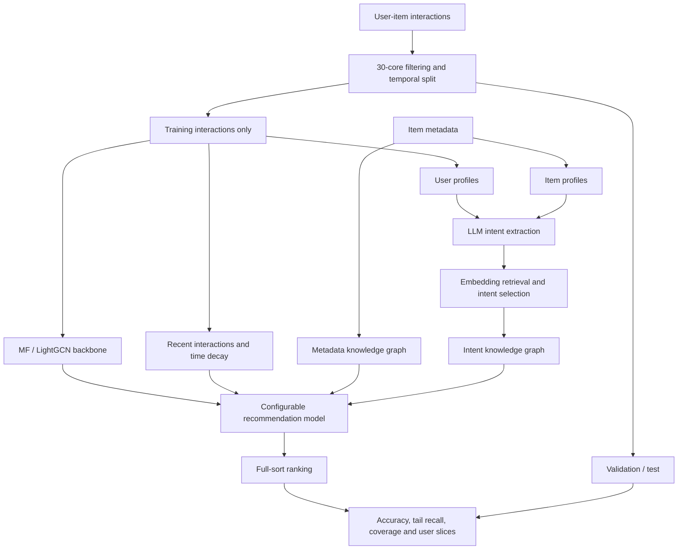

# Evaluating LLM-Derived Intent, Metadata, and Recency in Recommender Systems

**Recency for Accuracy, Metadata for the Long Tail**  
최근성은 추천 정확도를, 메타데이터는 롱테일 아이템 검색을 개선한다.

[한국어](README.md) | [English](README_EN.md) | [최종 보고서 (PDF)](Evaluating%20LLM-Derived%20Intent%2C%20Metadata%2C%20and%20Recency%20in%20Recommender%20Systems.pdf) | [연구 포스터 (PDF)](Kim_Yoo_Evaluating_LLM.pdf)

`Python 3.11` · `PyTorch` · `RecBole` · `LLM / RAG` · `Knowledge Graph`

한양대학교 데이터사이언스학부 졸업 프로젝트 (2026) — 김진욱 · 유은선, 지도교수 김현준.

MovieLens 25M과 Goodreads Children에서 협업 필터링(CF)에 최근성, 아이템 메타데이터, LLM 기반 의도를 결합하고 각 신호의 독립적·결합 효과를 분석한다. **제안 모델은 기존 MF 아이템 임베딩과 학습 가능한 스칼라 하나만 활용하는 MF + Recency**이며, 메타데이터와 LLM 의도는 별도의 ablation으로 평가한다.

## 1. 연구 배경과 질문

Amazon Clothing, MovieLens, Goodreads의 탐색적 분석에서 연속된 상호작용의 카테고리가 달라져도 브랜드·시리즈·저자 속성이 우연 수준보다 자주 유지됨을 관찰했다(각각 6.5배, 3.8배, 16.4배). 이러한 행동 패턴 자체가 이미 학습된 CF 모델의 정확도 개선을 보장하지는 않는다. Amazon Clothing은 행동 분석에만 사용했다.

- 최근 이력을 시간 가중하여 반영하면 정적 CF보다 정확도가 개선되는가?
- 메타데이터 KG는 정확도와 별개로 관련 롱테일 아이템을 더 잘 검색하는가?
- 두 신호의 결합과 LLM 기반 Intent의 추가 효과는 어떠하며, 사용자 활동량에 따라 효과가 달라지는가?

## 2. 최종 실험 결과

최종 보고서 표 8–13 기준. 사용자별 시간순 분할(TO)의 test 결과이며 3개 seed(2020, 2021, 2022) 평균이다.

### 2.1 제안 모델과 기준선

| 모델 | MovieLens NDCG@10 | MovieLens Recall@10 | Goodreads NDCG@10 | Goodreads Recall@10 |
|---|---:|---:|---:|---:|
| BPR | 0.0877 | 0.0636 | 0.0818 | 0.0875 |
| LightGCN | 0.0848 | 0.0595 | 0.0878 | 0.0908 |
| MF | 0.0876 | 0.0636 | 0.0811 | 0.0870 |
| **MF + Recency (제안)** | **0.0898** | **0.0655** | **0.0913** | **0.0962** |

MF 대비 NDCG@10 상대 개선율은 MovieLens **+2.5%**, Goodreads **+12.5%**다. 사용자별 paired bootstrap 95% CI(절대 차이)는 각각 [+0.0019, +0.0025], [+0.0095, +0.0108]로 모두 0을 포함하지 않는다. 다른 백본 간 비교에는 학습 예산 및 일부 실행 환경 차이가 영향을 줄 수 있다.

### 2.2 MF 구성요소별 ablation

| 모델 | ML NDCG@10 | ML Tail R@10 | ML Cov@10 | GR NDCG@10 | GR Tail R@10 | GR Cov@10 |
|---|---:|---:|---:|---:|---:|---:|
| MF | 0.0876 | 0.0023 | 0.450 | 0.0811 | 0.0111 | 0.502 |
| + Metadata KG | 0.0867 | **0.0031** | **0.510** | 0.0819 | 0.0127 | **0.562** |
| + Recency (제안) | **0.0898** | 0.0020 | 0.398 | **0.0913** | 0.0110 | 0.405 |
| + KG + Recency | 0.0892 | 0.0022 | 0.413 | 0.0849 | 0.0128 | 0.451 |
| + KG + Recency + LLM Intent | 0.0893 | 0.0021 | 0.410 | 0.0845 | **0.0132** | 0.466 |

- **Recency:** 두 도메인에서 정확도가 개선되었으나 Coverage@10은 감소했다.
- **Metadata KG:** 단독 추가 시 MF 대비 Tail Recall@10은 MovieLens 약 35%, Goodreads 약 14% 증가했고 Coverage도 증가했다.
- **비가산적 결합 효과:** KG + Recency는 Recency 단독 대비 NDCG@10이 MovieLens 약 0.7%, Goodreads 약 7.0% 낮았다. 독립적 개선 효과를 단순 합산할 수 없다.
- **LLM Intent:** 고정 projection 및 additive fusion에서 추가 정확도 개선이 확인되지 않았다. MovieLens MF의 소폭 상승은 통계적으로 유의하지 않았고 Goodreads MF에서는 감소했다. 모든 LLM 기반 추천 방법에 대한 결론은 아니다.

### 2.3 사용자 활동량 및 롱테일 분석

학습 상호작용 수에 따라 사용자를 5분위(Q1: 최저, Q5: 최고)로 나눴다.

| MF + Recency 비교 기준 | Q1 | Q2 | Q3 | Q4 | Q5 |
|---|---:|---:|---:|---:|---:|
| MovieLens MF | +2.7% | +3.2% | +3.5% | +3.2% | +1.5% |
| Goodreads MF | +15.0% | +14.1% | +13.5% | +8.7% | +8.5% |
| Goodreads LightGCN | +10.4% | +8.8% | +5.9% | −1.0% | −9.6% |

Goodreads에서 MF + KG 단독의 효과는 저활동층(Q1–Q2)에서 양수, 고활동층(Q4–Q5)에서 음수였지만 MovieLens까지 일반화할 근거는 없다. 활동량별 검정에는 다중 비교 보정을 적용하지 않았다.

Goodreads에서 LightGCN + KG + Recency는 기본 LightGCN 대비 Tail Recall@10 0.0100 → 0.0154, Coverage@10 0.285 → 0.458로 개선되지만 NDCG@10은 0.0878 → 0.0864로 감소했다. 단순 인기도 패널티를 적용한 LightGCN(Tail Recall 0.0146, NDCG 0.0811)과 비교하면 유사한 롱테일 재현율에서 더 높은 정확도를 보였지만 커버리지는 더 낮았다. 이 비교는 KG와 최근성을 함께 변경하므로 KG 단독의 인과 효과로 해석하지 않는다.

**결론:** 정확도와 관련 롱테일 아이템 검색을 별도의 목표로 평가해야 한다. 점수 수준에서 최근성과 메타데이터를 분리 결합하거나 사용자별로 선택 적용하는 방식은 향후 연구이며 본 연구에서 검증된 방법은 아니다.

위 결과는 최종 보고서에 보고된 실험값으로, 공개 패키지를 새로 실행한 결과가 아니다.

## 3. 모델 및 파이프라인

### 3.1 제안 모델: MF + Recency

학습 구간의 최근 최대 50개 상호작용을 사용한다. 마지막 학습 상호작용 시각을 기준으로 시간 감쇠 상수 180일을 적용해 기존 아이템 임베딩의 가중 평균을 구한다.

$$
w_{uj}=\frac{\exp(-(t_u^{\mathrm{last}}-t_{uj})/\tau)}{\sum_{k\in H_u}\exp(-(t_u^{\mathrm{last}}-t_{uk})/\tau)},\qquad d_u=\sum_{j\in H_u}w_{uj}q_j
$$

$$
s(u,i)=(p_u+\alpha_d d_u)^\top q_i=p_u^\top q_i+\alpha_d\sum_{j\in H_u}w_{uj}q_j^\top q_i
$$

여기서 $p_u$, $q_i$는 MF 사용자·아이템 벡터, $H_u$는 최근 학습 이력, $\alpha_d$는 부호 제약 없이 학습되는 단일 스칼라다. 기존 CF 점수에 최근 아이템과 후보 아이템 간 시간 가중 내적을 추가하며 별도의 LLM 호출이나 KG가 필요하지 않다.

### 3.2 공통 실험 파이프라인



| 구성 | 역할 |
|---|---|
| MF / BPR / LightGCN | 협업 필터링 기준선. 추가 정보 모델은 MF 또는 LightGCN 백본을 사용한다. |
| Metadata KG | Goodreads 도서 속성과 MovieLens 영화 장르를 그래프 관계로 구성한다. |
| Recency | 학습 구간의 최근 상호작용을 시간 감쇠 가중치로 반영한다. |
| LLM Intent KG | 사용자·아이템 프로필에서 의도를 추출하고 임베딩 기반 후보 검색과 LLM 선택을 거쳐 그래프를 구축한다. |

기본 실행기는 MF, BPR, LightGCN과 두 백본별 Meta KG + Recency 및 Intent 추가 모델까지 7개 모델을 비교한다. MF + KG 및 MF + Recency 단독 조건은 6.4의 채널 ablation 실행기로 평가한다.

## 4. 데이터와 평가 설계

| 데이터셋 | 사용자 | 아이템 | 상호작용 (30-core 이후) |
|---|---:|---:|---:|
| [Goodreads Children](https://cseweb.ucsd.edu/~jmcauley/datasets/goodreads.html) | 62,142 | 27,975 | 6,237,437 |
| [MovieLens 25M](https://grouplens.org/datasets/movielens/25m/) | 133,684 | 15,785 | 24,046,865 |

- TO: 사용자별 시간순 80/10/10. TO_GLOBAL: 전체 시간순 70/10/20(MovieLens 추가 평가, warm-user 결과 포함).
- 공통 설정: 64차원 임베딩, Adam(lr 0.001, L2 1e-6), 최대 40 epoch, seed 2020·2021·2022, validation NDCG@10 기반 early stopping. Batch size: MovieLens 8192, Goodreads 2048.
- Full-sort 평가: NDCG@10(순위 정확도), Recall@10, Tail Recall@10(학습 인기도 하위 80% 정답을 가진 사용자 대상), Coverage@10(추천 목록에 등장한 카탈로그 비율). 사용자 단위 paired bootstrap 및 Wilcoxon 검정.
- 사용자 프로필, 최근성, 활동량·인기도 통계는 학습 구간에 한정한다. 사용자별 시간순 분할의 전역 시간 누수 가능성과 수집 시점 메타데이터의 한계는 8절 참고.

## 5. 저장소 구조

```text
.
├── README.md
├── README_EN.md
├── reproduce.py
├── requirements.txt
├── experiments/
│   ├── goodreads/
│   │   ├── ikgr_core/
│   │   ├── prompts/
│   │   ├── scripts/
│   │   ├── tests/
│   │   └── run_pipeline.py
│   └── movielens/
│       ├── data_adapters/
│       ├── ikgr_core/
│       ├── prompts/
│       ├── scripts/
│       ├── tests/
│       └── run_pipeline.py
└── tests/
```

주요 진입점: [reproduce.py](reproduce.py), [Goodreads](experiments/goodreads/), [MovieLens](experiments/movielens/). 각 실험의 `config.yaml`, `eval_slices.py`, `ikgr_core/model_ikgr.py`에서 설정, 평가, 모델 구현을 확인할 수 있다.

## 6. 설치 및 재현

Python 3.11 가상환경에서 저장소 루트를 작업 디렉터리로 사용한다. Windows PowerShell 및 NVIDIA CUDA 12.1 기준:

```powershell
py -3.11 -m venv .venv
.\.venv\Scripts\Activate.ps1
python -m pip install torch==2.3.0 --index-url https://download.pytorch.org/whl/cu121
python -m pip install -r requirements.txt
```

Linux에서는 `python3.11 -m venv .venv`, `source .venv/bin/activate`로 환경을 연 뒤 동일한 설치 명령을 실행한다. CPU 합성 데이터 테스트에는 PyTorch 인덱스를 `https://download.pytorch.org/whl/cpu`로 변경한다. 실제 전체 실험에는 GPU를 권장하며 Goodreads 전용 intent 필터 실험은 CUDA가 필요하다.

### 6.1 API 키 없이 데이터 준비 및 비용 추정

```bash
python reproduce.py goodreads prepare
python reproduce.py movielens prepare
```

다운로드만 하려면 `prepare`를 `download`로 변경한다. 파일 크기와 SHA-256을 검사하고 이미 존재하는 원본은 재사용한다. Goodreads JSON.gz는 `experiments/goodreads/`, MovieLens CSV는 `experiments/movielens/raw/ml-25m/`에 저장된다. [MovieLens SHA-256 출처](https://raw.githubusercontent.com/tensorflow/datasets/master/tensorflow_datasets/url_checksums/movielens.txt).

### 6.2 전체 실험 실행

각 실험 폴더의 `.env.example`을 `.env`로 복사하고 `LUXIA_API_KEY`를 설정한다. 공통 환경변수로도 실행할 수 있다. API에는 학습 이력으로 만든 사용자 프로필과 아이템 프로필이 전달된다. 현재 설정은 Luxia GPT-4o-mini 브리지와 `sentence-transformers/all-mpnet-base-v2` 인코더를 사용한다.

```bash
python reproduce.py goodreads run --split TO
python reproduce.py movielens run --split TO
python reproduce.py movielens run --split TO_GLOBAL
```

완료 단계와 유효 캐시를 재사용한다. 호출 수·예상 비용을 확인하고 `y`를 입력하면 연결 확인과 본 호출을 시작한다. `--max-usd 50`은 예상 비용 상단이 50달러를 넘으면 시작을 막으며 실제 청구 한도는 제공자에서 설정해야 한다. 한 seed만 실행하려면 `--seeds 2020`을 추가한다. 첫 RAG 실행에는 Hugging Face 모델 다운로드가 필요하다.

| 단계 | 처리 | 주요 산출물 |
|---|---|---|
| 0 · A · T | 변환, 30-core, 시간순 분할 | `data/kc_k30/ikgr-custom/ikgr-custom.inter` |
| P · S | 학습 프로필, 비용 추정 | `profiles_k30_<split>.csv`, `llm_cost_estimate.json` |
| B · C | Intent 추출, 검색 및 선택 | `step1_intents.csv`, `step2_related_intents.csv` |
| D | Intent 및 Metadata KG | `kg_pack.pt`, `meta_kg_pack.pt` |
| E · R | 누수 검증, 학습·평가·보고서 | `slice_eval_<split>_result.json`, `per_user_<split>/`, `report_<split>.md` |

결과는 각 실험의 `run_k30_TO/` 또는 `run_k30_TO_GLOBAL/`에 생성된다. MovieLens는 global warm-only 결과도 `report_TO_GLOBAL_warm.md`에 기록한다.

### 6.3 고정 입력을 이용한 과거 결과 대조

같은 프롬프트에서도 새 LLM 응답이 달라질 수 있다. 과거 intent를 고정한 재현에는 원본 평가 입력 번들이 필요하다. **번들은 이 공개 저장소에 포함되지 않는다.** 접근 권한이 있는 경우 새 실험과 분리된 체크아웃에 각 `data_bundle/`을 복사하고 체크섬 검사를 거쳐 푼다.

```bash
python experiments/goodreads/scripts/unpack_data_bundle.py
python reproduce.py goodreads evaluate --split TO
python experiments/movielens/scripts/unpack_data_bundle.py --split TO
python reproduce.py movielens evaluate --split TO
python experiments/movielens/scripts/unpack_data_bundle.py --split TO_GLOBAL
python reproduce.py movielens evaluate --split TO_GLOBAL
```

D 단계까지 완료했다면 바로 `evaluate`를 실행할 수 있다. Goodreads LightGCN+Intent 보충 비교는 seed 2020이며 통합 명령 기본값은 3 seed다.

### 6.4 세부 실험 및 사용자 분석

TO 그래프와 평가 입력을 먼저 준비한다. 채널 ablation은 데이터셋당 2개 조건 × 3 seed를 사용한다.

```bash
cd experiments/goodreads
python scripts/run_todo_5_8.py --run --phase all
python scripts/run_ablation_nov22.py all
python analyze_user_segments.py
cd ../movielens
python scripts/run_ablation_nov22.py all
python scripts/analyze_activity_ablation.py pair --label "MovieLens MF" --off_dir run_k30_TO/per_user_TO --off IKGR_kgoff --on IKGR_dyn_nointent --out analysis/activity_TO/movielens_mf
```

## 7. 테스트

실험별 모듈 이름이 동일하므로 별도 Python 프로세스로 실행한다. 스모크 테스트는 합성 데이터, 모의 API 및 모의 인코더로 시간 분할·학습·평가·캐시 재개·누수 차단을 검사하도록 구성되어 있다. 작업 폴더가 초기화되므로 새 임시 경로를 지정한다.

```powershell
$env:PYTHONUTF8 = "1"
python -m pytest -q tests
cd experiments/goodreads
python -m pytest -q tests
python -X utf8 tests/smoke_e2e.py --workdir "$env:TEMP/goodreads-smoke-$([guid]::NewGuid())"
cd ../movielens
python -m pytest -q tests
python -X utf8 tests/smoke_e2e.py --workdir "$env:TEMP/movielens-smoke-$([guid]::NewGuid())"
```

## 8. 한계 및 향후 연구

- 결과는 두 도메인의 30-core 데이터와 정적 CF 기준선에 한정된다. SASRec 등 순차 추천 모델과의 비교나 완전한 cold-start는 다루지 않았다.
- 사용자별 시간순 분할은 전역 시간순서를 보장하지 않는다. MovieLens 전역 분할 warm-user 평가에서 KG + Recency는 MF 대비 −0.4%(95% CI [−0.0037, +0.0018], 절대 NDCG 차이)였으며 Recency 단독은 해당 분할에서 평가하지 않았다. Goodreads shelf tag에는 수집 시점까지 누적된 정보가 포함된다.
- 동일 최대 40 epoch 예산 내에서 일부 기준선의 성능은 여전히 개선되고 있었고, 백본 간 GPU 및 평가 배치 차이가 있다. 균일 가중 평균과의 비교, 이력 길이 및 감쇠 상수 민감도, LightGCN의 완전한 2×2 ablation이 남아 있다.
- LLM Intent 실험은 하나의 추출기, 고정 projection, additive fusion에 한정된다. Goodreads LightGCN + Intent는 단일 seed 보충 실험이다.
- 활동량별 다중 비교 보정, 별도 점수 결합 및 사용자별 선택 적용, 온라인 평가가 필요하다. 관측된 정확도·롱테일 Pareto frontier는 보고된 평균값에 한정된다.

## 9. 데이터 및 참고 자료

- [UCSD Goodreads Book Graph](https://cseweb.ucsd.edu/~jmcauley/datasets/goodreads.html)
- [GroupLens MovieLens 25M](https://grouplens.org/datasets/movielens/25m/)
- [RecBole](https://github.com/RUCAIBox/RecBole)
- [LightGCN](https://arxiv.org/abs/2002.02126)
- [all-mpnet-base-v2](https://huggingface.co/sentence-transformers/all-mpnet-base-v2)

## 10. 라이선스 및 인용

- **소프트웨어:** 별도의 라이선스가 명시되지 않은 본 프로젝트의 자체 소스 코드 및 소프트웨어 문서는 [MIT License](LICENSE)를 따른다. `experiments/goodreads/`에는 기존 [Apache License 2.0](experiments/goodreads/LICENSE)이 적용되며, 기존 제3자 라이선스 및 저작권·출처 표시는 그대로 유지된다.
- **연구 보고서 및 포스터:** 저장소의 두 PDF는 MIT 라이선스 적용 대상이 아니며, 해당 저작권자에게 모든 권리가 유보된다. 저작권법상 허용되는 인용 등은 가능하다.
- **데이터 및 외부 의존성:** [MovieLens 25M](https://grouplens.org/datasets/movielens/25m/) 및 [Goodreads Children](https://cseweb.ucsd.edu/~jmcauley/datasets/goodreads.html)은 원본 배포자의 이용 조건을 따른다. 외부 라이브러리, 모델, API 및 그 산출물에도 각자의 이용 조건이 적용된다. 본 저장소의 MIT 라이선스가 이러한 권리를 변경하지 않는다.

본 소프트웨어나 연구를 활용하는 경우 [CITATION.cff](CITATION.cff) 또는 GitHub의 “Cite this repository”를 참고하여 인용해 주기 바란다.

> Kim, J.-U., & Yoo, E.-S. (2026). *Evaluating LLM-Derived Intent, Metadata, and Recency in Recommender Systems*. Graduation research project, Department of Data Science, Hanyang University.
