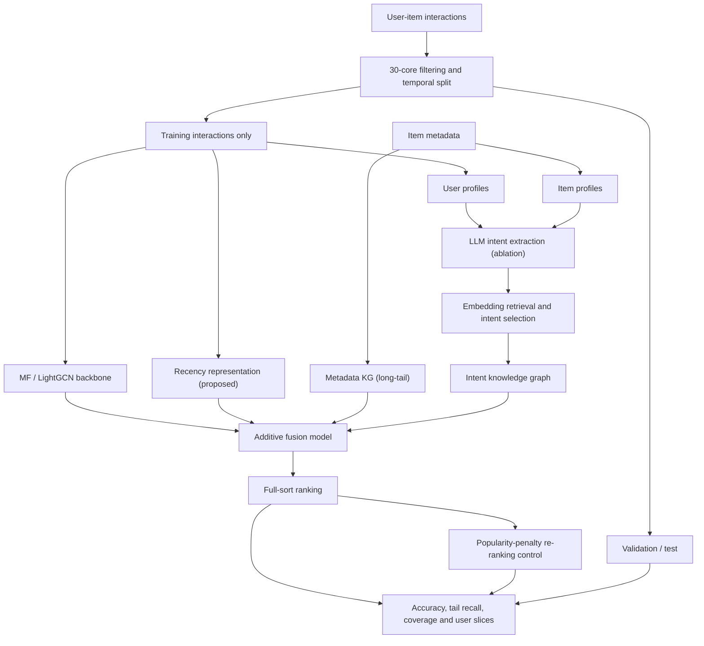

# Evaluating LLM-Derived Intent, Metadata, and Recency in Recommender Systems

**LLM 기반 의도, 아이템 메타데이터, 최근성이 추천 성능에 미치는 영향**

[한국어](README.md) | [English](README_EN.md)

`Python 3.11` · `PyTorch` · `RecBole` · `LLM / RAG` · `Knowledge Graph`

한양대학교 데이터사이언스학과 졸업 프로젝트의 실험 코드와 재현 절차를 담은 저장소다. 협업 필터링(CF)에 세 가지 보조 신호를 하나씩 켜고 끄며 더해, 각 신호가 추천 정확도와 롱테일 추천에 실제로 기여하는지 Goodreads Children과 MovieLens 25M에서 평가했다.

- LLM이 추론한 사용자 의도(intent)
- 아이템 메타데이터 지식 그래프(Meta KG)
- 최근성(Recency)

> **핵심 결과**
> - 정확도 이득은 최근성에서 나왔다. MF에 최근성 표현만 더한 제안 모델이 NDCG@10을 MovieLens에서 +2.5%, Goodreads에서 +12.5% 높였다.
> - LLM intent는 추가 이득이 없었다.
> - 메타데이터 KG는 정확도보다 롱테일 노출을 늘렸다.

## 1. 연구 배경과 질문

탐색적 분석([graduate_eda](https://github.com/HK1DS/graduate_eda))에서 두 가지 패턴을 관찰했다.
- 연속으로 소비한 아이템은 카테고리가 바뀌어도 저자나 브랜드 같은 속성을 무작위보다 자주 공유한다.
- 시간적으로 가까운 상호작용일수록 서로 더 비슷하다.

이를 바탕으로 다음 질문을 다룬다.

- **RQ1.** 최근성, 메타데이터 KG, LLM intent 중 어떤 신호가 MF 기반 추천의 정확도를 높이는가?
- **RQ2.** LLM intent는 다른 신호 이상의 추가 이득을 주는가?
- **RQ3.** 정확도와 롱테일 추천 사이에는 어떤 상충 관계가 있으며, 메타데이터 KG를 롱테일 추천에 어떻게 활용할 수 있는가?

## 2. 주요 실험 결과

사용자별 시간순 분할(TO)의 test 결과이며, seed 3개(2020·2021·2022)의 평균이다. 대괄호는 사용자 단위 paired bootstrap 95% 신뢰구간(CI)이다.

| 모델 | 구분 | ML NDCG@10 | ML Tail R@10 | ML Cov@10 | GR NDCG@10 | GR Tail R@10 | GR Cov@10 |
|---|---|---:|---:|---:|---:|---:|---:|
| MF | 기준선 | 0.0876 | 0.0023 | 0.450 | 0.0811 | 0.0111 | 0.502 |
| BPR | 기준선 | 0.0877 | 0.0024 | 0.457 | 0.0818 | 0.0113 | 0.504 |
| LightGCN | 기준선 | 0.0848 | 0.0008 | 0.287 | 0.0878† | 0.0100† | 0.285† |
| **MF + Recency** | **제안 모델** | **0.0898** | 0.0020 | 0.398 | **0.0913** | 0.0110 | 0.405 |
| MF + Meta KG | ablation | 0.0867 | **0.0031** | **0.510** | 0.0819 | 0.0127 | **0.562** |
| MF + Meta KG + Recency | ablation | 0.0892 | 0.0022 | 0.413 | 0.0849 | 0.0128 | 0.451 |
| MF + Meta KG + Recency + Intent | ablation | 0.0893 | 0.0021 | 0.410 | 0.0845 | 0.0132 | 0.466 |
| LightGCN + Meta KG + Recency | 롱테일 비교 | 0.0883 | 0.0014 | 0.321 | 0.0864† | **0.0154**† | 0.458† |

- ML = MovieLens 25M, GR = Goodreads Children.
- Tail R@10: 학습 구간 인기도 하위 80% 아이템에 대한 Recall@10.
- Cov@10: 전체 아이템 중 사용자들의 상위 10개 추천에 한 번 이상 나온 아이템의 비율.
- † Goodreads LightGCN 계열은 MF 계열과 실행 장비와 평가 배치가 달라, 백본끼리 직접 비교하지 않는다.

**최근성 (제안 모델)**
- MF 대비 NDCG@10이 MovieLens에서 +2.5% [+0.0019, +0.0025], Goodreads에서 +12.5% [+0.0095, +0.0108] 올랐다.
- 두 데이터셋 모두 사용자 활동량 5개 구간 전부에서 유의했다.
- 추가 파라미터는 스칼라 가중치 하나다.
- 대신 Coverage@10이 MovieLens 0.450 → 0.398, Goodreads 0.502 → 0.405로 줄었다.

**LLM intent**
- 추가 이득이 없었다.
- MF 백본: MovieLens +0.1% [−0.0001, +0.0003], Goodreads −0.5%.
- LightGCN 백본: 두 데이터셋 모두 −0.8%. Goodreads LightGCN + intent는 seed 2020 하나만 실행했다.

**메타데이터 KG**
- NDCG@10 변화는 MovieLens −1.0%, Goodreads +0.9%로 작았다.
- 롱테일 지표는 늘었다.

| 지표 | MovieLens | Goodreads |
|---|---|---|
| Tail Recall@10 | +35% | +14% |
| Coverage@10 | 0.45 → 0.51 | 0.50 → 0.56 |

**결합 시 간섭**
- 메타데이터 KG를 최근성과 같은 임베딩에 더하면, 최근성만 쓴 모델보다 NDCG@10이 MovieLens에서 −0.7%, Goodreads에서 −7.8% 낮았다.
- 즉 Goodreads 결합 모델의 +4.7%는, 최근성이 낸 +12.5%가 메타데이터 KG 때문에 깎인 결과다.

**인기도 보정과의 비교 (Goodreads)**
- 인기도 페널티 재랭킹(λ = 0.25)을 적용한 LightGCN과, 페널티 없이 메타데이터 KG와 최근성을 더한 LightGCN을 비교했다.
- 롱테일 수준은 비슷했다(Tail R@10 0.0146 vs 0.0154).
- NDCG@10은 메타데이터 KG 쪽이 6.5% 높았다 [+0.0046, +0.0060].
- Coverage@10은 페널티 쪽이 더 넓었다(0.501 vs 0.458).
- MovieLens에서는 같은 롱테일 수준에서 비교할 지점이 없었다.

**활동량별 차이**
- Goodreads에서 메타데이터 KG는 저활동 사용자에게 이득이었고(Q1 +3.2%, Q2 +2.0%), 고활동 사용자에게는 손해였다(Q4 −1.5%, Q5 −2.2%).
- MovieLens에서는 저활동 구간에서도 손해였다(Q1 −2.1%).

## 3. 모델 및 파이프라인



각 신호는 백본 임베딩에 더하는 가산 결합 방식으로 들어가며, 설정에서 하나씩 켜고 끌 수 있다.

```text
user  u = e_u + α_d · r_u  (+ α_k · k_u)
item  i = e_i + Σ_r α_r · m_{i,r}  (+ α_k · k_i)
score ŷ = uᵀ i,  BPR loss
```

| 구성 | 역할 |
|---|---|
| MF / BPR / LightGCN | 협업 필터링 기준선. 보조 신호를 더하는 모델은 MF 또는 LightGCN을 백본으로 쓴다. |
| Recency (제안) | 사용자 학습 구간의 최근 상호작용 50개에 대해 아이템 임베딩을 시간 감쇠(τ = 180일)로 가중 평균한 `r_u`를 더한다. 추가 파라미터는 `α_d` 하나다. |
| Metadata KG (롱테일) | 아이템을 속성 노드에 연결한 그래프다. 관계별 평균 표현 `m_{i,r}`을 가중치 `α_r`로 더한다. Goodreads는 저자, 출판사, shelf 태그 관계를, MovieLens는 장르 관계를 쓴다. |
| LLM Intent KG (ablation) | 다음 두 단계로 intent를 연결한 그래프를 만든다. ① 학습 구간 프로필로 LLM이 intent를 추출한다. ② 임베딩 kNN으로 후보 intent를 찾고, LLM이 그중 관련 있는 것을 고른다. intent 임베딩은 고정된다. |
| 인기도 페널티 재랭킹 | 롱테일 대조군. 학습된 점수에서 `λ · σ_u · z(log(1 + pop_i))`를 빼서 순위를 다시 매긴다. 재학습은 하지 않는다. |

## 4. 데이터와 평가 설계

| 데이터셋 | 사용자 | 아이템 | 상호작용 (30-core 이후) |
|---|---:|---:|---:|
| [Goodreads Children](https://cseweb.ucsd.edu/~jmcauley/datasets/goodreads.html) | 62,142 | 27,975 | 6,237,437 |
| [MovieLens 25M](https://grouplens.org/datasets/movielens/25m/) | 133,684 | 15,785 | 24,046,865 |

- **TO:** 사용자별 시간순 train/validation/test = 80/10/10. 두 데이터셋의 주요 비교에 쓴다.
- **TO_GLOBAL:** 전체 시간순 70/10/20. MovieLens에서만 추가로 평가했으며, warm-user 결과도 따로 낸다.
- **공통 설정:** 64차원 임베딩, 최대 40 epoch, seed 2020·2021·2022, validation NDCG@10 기반 early stopping. 모든 모델을 같은 학습 예산에서 비교한다.
- **평가:** full-sort 방식, 지표는 NDCG, Recall, Hit, Tail Recall, Coverage.
  - 사용자 활동량 5분위별·아이템 인기도별 분석을 함께 한다.
  - 검정은 사용자 단위 paired bootstrap(10,000회)과 Wilcoxon 검정을 쓴다.
  - 롱테일 아이템은 학습 구간 인기도 하위 80%로 정의한다.
- **누수 방지:** 사용자 프로필, LLM 입력, 최근성, 활동량·인기도 통계는 모두 학습 구간에서만 만든다. 평가 시 프로필 provenance와 실제 train split을 대조한다.

## 5. 저장소 구조

```text
.
├── reproduce.py
├── requirements.txt
├── experiments/
│   ├── goodreads/
│   │   ├── ikgr_core/
│   │   ├── prompts/
│   │   ├── scripts/
│   │   ├── tests/
│   │   └── run_pipeline.py
│   └── movielens/
│       ├── data_adapters/
│       ├── ikgr_core/
│       ├── prompts/
│       ├── scripts/
│       ├── tests/
│       └── run_pipeline.py
└── tests/
```

주요 진입점: [reproduce.py](reproduce.py), [Goodreads](experiments/goodreads/), [MovieLens](experiments/movielens/). 각 실험의 `config.yaml`, `eval_slices.py`, `ikgr_core/model_ikgr.py`에서 설정, 평가, 모델 구현을 확인할 수 있다.

## 6. 설치 및 재현

Python 3.11 가상환경에서 저장소 루트를 작업 디렉터리로 사용한다. Windows PowerShell 및 NVIDIA CUDA 12.1 기준:

```powershell
py -3.11 -m venv .venv
.\.venv\Scripts\Activate.ps1
python -m pip install torch==2.3.0 --index-url https://download.pytorch.org/whl/cu121
python -m pip install -r requirements.txt
```

Linux에서는 `python3.11 -m venv .venv`, `source .venv/bin/activate`로 환경을 연 뒤 동일한 설치 명령을 실행한다. CPU 합성 데이터 테스트에는 PyTorch 인덱스를 `https://download.pytorch.org/whl/cpu`로 변경한다. 실제 전체 실험에는 GPU를 권장하며 Goodreads 전용 intent 필터 실험은 CUDA가 필요하다.

### 6.1 API 키 없이 데이터 준비 및 비용 추정

```bash
python reproduce.py goodreads prepare
python reproduce.py movielens prepare
```

다운로드만 하려면 `prepare`를 `download`로 변경한다. 파일 크기와 SHA-256을 검사하고 이미 존재하는 원본은 재사용한다. Goodreads 상호작용·도서·저자 JSON.gz는 `experiments/goodreads/`, MovieLens CSV는 `experiments/movielens/raw/ml-25m/`에 저장된다. [MovieLens SHA-256 출처](https://raw.githubusercontent.com/tensorflow/datasets/master/tensorflow_datasets/url_checksums/movielens.txt).

### 6.2 전체 실험 실행

각 실험 폴더의 `.env.example`을 `.env`로 복사하고 `LUXIA_API_KEY`를 설정한다. 공통 환경변수 `LUXIA_API_KEY`로도 두 실험을 실행할 수 있다. API에는 학습 이력으로 만든 사용자 프로필과 아이템 프로필이 전달된다. 현재 설정은 Luxia GPT-4o-mini 브리지와 `sentence-transformers/all-mpnet-base-v2` 인코더를 사용한다.

```bash
python reproduce.py goodreads run --split TO
python reproduce.py movielens run --split TO
python reproduce.py movielens run --split TO_GLOBAL
```

완료된 단계와 유효 캐시를 재사용한다. 호출 수·예상 비용을 확인하고 `y`를 입력하면 연결 확인과 본 호출을 시작한다. `--max-usd 50`은 예상 비용 상단이 50달러를 넘으면 시작을 막으며 실제 청구 한도는 제공자에서 설정해야 한다. 한 seed만 실행하려면 `--seeds 2020`을 추가한다. 첫 RAG 실행 시 Hugging Face 모델 다운로드가 필요하다.

| 단계 | 처리 | 주요 산출물 |
|---|---|---|
| 0 · A · T | 변환, 30-core, 시간순 분할 | `data/kc_k30/ikgr-custom/ikgr-custom.inter` |
| P · S | 학습 프로필, 비용 추정 | `profiles_k30_<split>.csv`, `llm_cost_estimate.json` |
| B · C | Intent 추출, 검색 및 선택 | `step1_intents.csv`, `step2_related_intents.csv` |
| D | Intent 및 Metadata KG | `kg_pack.pt`, `meta_kg_pack.pt` |
| E · R | 누수 검증, 학습·평가·보고서 | `slice_eval_<split>_result.json`, `per_user_<split>/`, `report_<split>.md` |

결과는 각 실험의 `run_k30_TO/` 또는 `run_k30_TO_GLOBAL/`에 생성된다. MovieLens는 global warm-only 결과도 `report_TO_GLOBAL_warm.md`에 기록한다.

### 6.3 고정 입력을 이용한 과거 결과 대조

같은 프롬프트에서도 새 LLM 응답이 달라질 수 있다. 과거 intent를 고정한 재현에는 원본 평가 입력 번들이 필요하다. **번들은 이 공개 저장소에 포함되지 않는다.** 접근 권한이 있는 경우 새 실험과 분리된 체크아웃에 각 `data_bundle/`을 복사하고 체크섬 검사를 거쳐 푼다.

```bash
python experiments/goodreads/scripts/unpack_data_bundle.py
python reproduce.py goodreads evaluate --split TO
python experiments/movielens/scripts/unpack_data_bundle.py --split TO
python reproduce.py movielens evaluate --split TO
python experiments/movielens/scripts/unpack_data_bundle.py --split TO_GLOBAL
python reproduce.py movielens evaluate --split TO_GLOBAL
```

D 단계까지 완료했다면 바로 `evaluate`를 실행할 수 있다. Goodreads 원 보고서의 LightGCN+intent 발표 수치는 seed 2020이며 통합 명령 기본값은 3 seed다. MovieLens 원 보고서는 분할별 7개 모델 × 3 seed 평균이다.

### 6.4 세부 실험 및 사용자 분석

TO 그래프와 평가 입력을 먼저 준비한다. 채널 ablation은 데이터셋마다 두 조건을 seed 3개로 실행한다.
- 메타데이터만: `IKGR_meta_only_nov22`
- 최근성만(제안 모델): `IKGR_recency_only_nov22`

여기에 MF(`IKGR_kgoff`)와 기존 결합 모델(`IKGR_dyn_nointent`)을 더해 2×2 요인 분해를 계산한다.

```bash
cd experiments/goodreads
python scripts/run_todo_5_8.py --run --phase all
python scripts/run_ablation_nov22.py all
python analyze_user_segments.py
cd ../movielens
python scripts/run_ablation_nov22.py all
python scripts/analyze_activity_ablation.py pair --label "MovieLens MF" --off_dir run_k30_TO/per_user_TO --off IKGR_kgoff --on IKGR_dyn_nointent --out analysis/activity_TO/movielens_mf
python scripts/analyze_activity_ablation.py factorial --label "MovieLens MF" --base IKGR_kgoff=run_k30_TO --meta IKGR_meta_only_nov22=run_k30_TO/ablation_nov22 --rec IKGR_recency_only_nov22=run_k30_TO/ablation_nov22 --both IKGR_dyn_nointent=run_k30_TO --out analysis/activity_TO/movielens_factorial_test
```

`factorial`의 각 인자는 `스펙=실행 폴더` 형식이다. 실행 폴더 안의 `per_user_TO/`를 읽는다.

## 7. 테스트

실험별 모듈 이름이 동일하므로 별도 Python 프로세스로 실행한다. 스모크 테스트는 합성 데이터, 로컬 모의 API 및 모의 인코더를 사용해 시간 분할·학습·평가·캐시 재개·누수 차단을 검사하도록 구성되어 있다. 작업 폴더가 초기화되므로 새 임시 경로를 지정한다.

```powershell
$env:PYTHONUTF8 = "1"
python -m pytest -q tests
cd experiments/goodreads
python -m pytest -q tests
python -X utf8 tests/smoke_e2e.py --workdir "$env:TEMP/goodreads-smoke-$([guid]::NewGuid())"
cd ../movielens
python -m pytest -q tests
python -X utf8 tests/smoke_e2e.py --workdir "$env:TEMP/movielens-smoke-$([guid]::NewGuid())"
```

## 8. 한계

**데이터와 조건**
- **데이터셋 수:** 실험 크레딧(LLM API 호출, GPU 임대) 제약으로 Amazon Clothing을 제외했다. 최종 실험은 Goodreads와 MovieLens 두 데이터셋이다.
- **필터 조건:** (30, 30)-core 조건 하나만 사용했다. 모든 사용자의 학습 상호작용이 24개 이상이므로, 결과를 완전한 cold-start나 더 희소한 조건으로 일반화할 수 없다.

**분할 방식**
- 주요 결과는 사용자별 시간순 분할(TO)에서 얻었다.
- MovieLens 전역 시간 분할(warm 사용자 3,186명)에서는 MF + Meta KG + Recency가 MF와 차이를 보이지 않았다(−0.4%, [−0.0037, +0.0018]).
- 최근성만 쓴 제안 모델은 전역 시간 분할에서 평가하지 않았다.

**비교 조건**
- 모든 모델을 최대 40 epoch라는 같은 예산으로 비교했다. 일부 기준선(예: Goodreads MF, LightGCN)은 이 상한 근처에서 멈췄다.
- 순차 추천 모델(SASRec 등)과는 비교하지 않았다.

**하지 못한 ablation**
- 최근성의 τ와 이력 길이에 대한 민감도 분석
- LightGCN 백본에서의 메타데이터 × 최근성 2×2 실험
- intent의 다른 구성(다른 LLM, 다른 임베딩, 학습 가능한 투영)
- 최근성만 쓴 모델에 인기도 페널티를 적용한 비교

**해석상 주의**
- LLM intent는 관측된 실제 의도가 아니라 추정값이다. 비용, 응답 변동, 범용 intent 노이즈의 영향을 받는다. 무효과의 원인이 intent 품질인지 결합 방식인지는 분리하지 못했다.
- 메타데이터 KG와 최근성의 간섭 원인은 직접 검증하지 않은 가설이다.
- 활동량에 따른 메타데이터 KG의 효과 차이는 Goodreads에서만 관찰되었다.

## 9. 보고서와 코드 대응

| 보고서 | 내용 | 코드 |
|---|---|---|
| 3장 | 사용자 행동 분석 | [graduate_eda](https://github.com/HK1DS/graduate_eda) |
| 4장 | 가산 결합 모델 | `experiments/*/ikgr_core/model_ikgr.py` (`_emb_users`, `_emb_items`) |
| 4장 | 최근성 표현 | `experiments/*/eval_slices.py`의 `_build_recency`. 기본값 `recency_topn = 50`, `recency_tau_days = 180`은 `model_ikgr.py`에 있다 |
| 4장 | 메타데이터 KG | `experiments/*/build_meta_kg.py` |
| 4장 | LLM intent | `experiments/*/step1.py`, `step2.py`, `prompts/`, `ikgr_core/rag.py`, `build_kg.py` |
| 4장 | 누수 방지 | `experiments/*/build_trainonly_profiles.py`, `ikgr_core/temporal_split.py` |
| 5장 | 기준선과 주요 비교 | `reproduce.py`, `experiments/*/run_pipeline.py`, `config.yaml` |
| 5장 | 2×2 ablation과 활동량 분석 | `experiments/*/scripts/run_ablation_nov22.py`, `experiments/movielens/scripts/analyze_activity_ablation.py` |
| 5장 | 사용자 단위 검정 | `experiments/*/paired_compare.py` |
| 6장 | 인기도 페널티 재랭킹 | `experiments/*/eval_slices.py`의 `_pop_penalty_scores` (`pop_rerank_grid`) |
| 7장 | 전역 시간 분할 warm-user 평가 | `experiments/movielens/eval_global_warm.py` |

## 10. 데이터 및 참고 자료

- [UCSD Goodreads Book Graph](https://cseweb.ucsd.edu/~jmcauley/datasets/goodreads.html)
- [GroupLens MovieLens 25M](https://grouplens.org/datasets/movielens/25m/)
- [RecBole](https://github.com/RUCAIBox/RecBole)
- [LightGCN](https://arxiv.org/abs/2002.02126)
- [all-mpnet-base-v2](https://huggingface.co/sentence-transformers/all-mpnet-base-v2)
- [KGIN](https://arxiv.org/abs/2102.07057)
- [KAR](https://arxiv.org/abs/2306.10933)
- [DynLLM](https://arxiv.org/abs/2405.07580)
- [CORONA](https://arxiv.org/abs/2506.17281)
