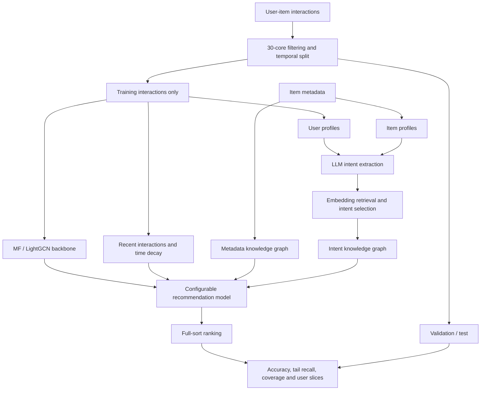

# Evaluating LLM-Derived Intent, Metadata, and Recency in Recommender Systems

**LLM 기반 의도, 아이템 메타데이터, 최근성이 추천 성능에 미치는 영향**

[한국어](README.md) | [English](README_EN.md)

`Python 3.11` · `PyTorch` · `RecBole` · `LLM / RAG` · `Knowledge Graph`

Goodreads Children과 MovieLens 25M에서 협업 필터링(CF)에 추가 정보를 결합하고, 추천 정확도와 롱테일 추천에 실제로 기여하는 신호가 무엇인지 분석한다. 이 저장소는 두 실험의 코드와 재현 절차를 하나로 통합한다.

## 1. 연구 배경과 질문

탐색적 분석에서 연속된 상호작용의 대표 카테고리나 장르가 달라져도 저자나 브랜드 같은 속성 선호가 유지되는 패턴을 관찰했다. 이를 출발점으로 변화하는 관심과 지속되는 선호를 함께 반영하는 추천 구조를 검토한다.

- 메타데이터 지식 그래프(Meta KG)와 최근성(Recency)의 결합은 CF 기준선보다 정확도를 높이는가?
- LLM 기반 Intent는 메타데이터와 최근성 이상의 추가 정보를 제공하는가?
- 추가 정보의 효과는 사용자 활동량에 따라 어떻게 달라지며, 정확도와 롱테일 추천 사이에 어떤 상충 관계가 나타나는가?

## 2. 주요 실험 결과

2026년 11월 19일 추가 실험 보고서 기준 대표 결과. 사용자별 시간순 분할(TO)의 test NDCG@10, 3 seed 평균이다.

| 모델 | MovieLens 25M | Goodreads Children |
|---|---:|---:|
| MF (KG-off) | 0.0876 | 0.0811 |
| BPR | 0.0877 | 0.0818 |
| LightGCN | 0.0848 | 0.0878 |
| MF + Meta KG + Recency | 0.0892 | 0.0849 |
| MF + Meta KG + Recency + Intent | 0.0893 | 0.0845 |
| LightGCN + Meta KG + Recency | 0.0883 | 0.0864 |

- **메타데이터 + 최근성:** MF 대비 NDCG@10 상대 개선율은 MovieLens **+1.8%**, Goodreads **+4.7%**.
- **LLM Intent:** 추가 이득은 일관되지 않았다. MovieLens MF에서의 소폭 상승은 보고서의 paired 검정에서 유의하지 않았으며, Goodreads MF에서는 감소했다.
- **롱테일:** Goodreads LightGCN에 메타데이터와 최근성을 결합하면 Tail Recall@10은 0.0100 → 0.0154로 증가했으나 NDCG@10은 0.0878 → 0.0864로 감소했다.
- **사용자 이질성:** Goodreads에서 저활동 사용자에게 추가 정보가 상대적으로 유리하고 고활동 사용자에게 불리한 경향이 관찰되었다. 이를 모든 데이터셋에 일반화하지 않는다.

위 표는 과거 보고된 주요 모델의 발췌이며, 공개 패키지를 새로 실행한 결과가 아니다. 메타데이터와 최근성의 결합 효과는 개별 채널의 ablation과 구분한다.

## 3. 모델 및 파이프라인



| 구성 | 역할 |
|---|---|
| MF / BPR / LightGCN | 협업 필터링 기준선. 추가 정보 모델은 MF 또는 LightGCN 백본을 사용한다. |
| Metadata KG | Goodreads 도서 속성과 MovieLens 영화 장르를 그래프 관계로 구성한다. |
| Recency | 학습 구간의 최근 상호작용을 시간 감쇠 가중치로 반영한다. |
| LLM Intent KG | 사용자·아이템 프로필에서 의도를 추출하고 임베딩 기반 후보 검색과 LLM 선택을 거쳐 그래프를 구축한다. |

기본 비교는 MF, BPR, LightGCN과 두 백본별 Meta KG + Recency 및 Intent 추가 모델까지 7개 모델이다. 별도 ablation 실행기는 채널 단위 비교를 지원한다.

## 4. 데이터와 평가 설계

| 데이터셋 | 사용자 | 아이템 | 상호작용 (30-core 이후) |
|---|---:|---:|---:|
| [Goodreads Children](https://cseweb.ucsd.edu/~jmcauley/datasets/goodreads.html) | 62,142 | 27,975 | 6,237,437 |
| [MovieLens 25M](https://grouplens.org/datasets/movielens/25m/) | 133,684 | 15,785 | 24,046,865 |

- **TO:** 사용자별 시간순 train/validation/test = 80/10/10. 두 데이터셋의 주요 비교.
- **TO_GLOBAL:** 전체 시간순 70/10/20. MovieLens 추가 평가 및 warm-user 결과.
- **공통 설정:** 64차원 임베딩, 최대 40 epoch, seed 2020·2021·2022, validation NDCG@10 기반 early stopping.
- **평가:** full-sort, NDCG, Recall, Hit, Tail Recall, Coverage 및 사용자 활동량·아이템 인기도별 분석. 사용자 단위 paired bootstrap 및 Wilcoxon 검정.
- **누수 방지:** 사용자 프로필, 최근성, 활동량·인기도 통계는 학습 구간에 한정한다. 평가 시 프로필 provenance와 실제 train split을 대조한다.

## 5. 저장소 구조

```text
.
├── reproduce.py
├── requirements.txt
├── experiments/
│   ├── goodreads/
│   │   ├── ikgr_core/
│   │   ├── prompts/
│   │   ├── scripts/
│   │   ├── tests/
│   │   └── run_pipeline.py
│   └── movielens/
│       ├── data_adapters/
│       ├── ikgr_core/
│       ├── prompts/
│       ├── scripts/
│       ├── tests/
│       └── run_pipeline.py
└── tests/
```

주요 진입점: [reproduce.py](reproduce.py), [Goodreads](experiments/goodreads/), [MovieLens](experiments/movielens/). 각 실험의 `config.yaml`, `eval_slices.py`, `ikgr_core/model_ikgr.py`에서 설정, 평가, 모델 구현을 확인할 수 있다.

## 6. 설치 및 재현

Python 3.11 가상환경에서 저장소 루트를 작업 디렉터리로 사용한다. Windows PowerShell 및 NVIDIA CUDA 12.1 기준:

```powershell
py -3.11 -m venv .venv
.\.venv\Scripts\Activate.ps1
python -m pip install torch==2.3.0 --index-url https://download.pytorch.org/whl/cu121
python -m pip install -r requirements.txt
```

Linux에서는 `python3.11 -m venv .venv`, `source .venv/bin/activate`로 환경을 연 뒤 동일한 설치 명령을 실행한다. CPU 합성 데이터 테스트에는 PyTorch 인덱스를 `https://download.pytorch.org/whl/cpu`로 변경한다. 실제 전체 실험에는 GPU를 권장하며 Goodreads 전용 intent 필터 실험은 CUDA가 필요하다.

### 6.1 API 키 없이 데이터 준비 및 비용 추정

```bash
python reproduce.py goodreads prepare
python reproduce.py movielens prepare
```

다운로드만 하려면 `prepare`를 `download`로 변경한다. 파일 크기와 SHA-256을 검사하고 이미 존재하는 원본은 재사용한다. Goodreads 상호작용·도서·저자 JSON.gz는 `experiments/goodreads/`, MovieLens CSV는 `experiments/movielens/raw/ml-25m/`에 저장된다. [MovieLens SHA-256 출처](https://raw.githubusercontent.com/tensorflow/datasets/master/tensorflow_datasets/url_checksums/movielens.txt).

### 6.2 전체 실험 실행

각 실험 폴더의 `.env.example`을 `.env`로 복사하고 `LUXIA_API_KEY`를 설정한다. 공통 환경변수 `LUXIA_API_KEY`로도 두 실험을 실행할 수 있다. API에는 학습 이력으로 만든 사용자 프로필과 아이템 프로필이 전달된다. 현재 설정은 Luxia GPT-4o-mini 브리지와 `sentence-transformers/all-mpnet-base-v2` 인코더를 사용한다.

```bash
python reproduce.py goodreads run --split TO
python reproduce.py movielens run --split TO
python reproduce.py movielens run --split TO_GLOBAL
```

완료된 단계와 유효 캐시를 재사용한다. 호출 수·예상 비용을 확인하고 `y`를 입력하면 연결 확인과 본 호출을 시작한다. `--max-usd 50`은 예상 비용 상단이 50달러를 넘으면 시작을 막으며 실제 청구 한도는 제공자에서 설정해야 한다. 한 seed만 실행하려면 `--seeds 2020`을 추가한다. 첫 RAG 실행 시 Hugging Face 모델 다운로드가 필요하다.

| 단계 | 처리 | 주요 산출물 |
|---|---|---|
| 0 · A · T | 변환, 30-core, 시간순 분할 | `data/kc_k30/ikgr-custom/ikgr-custom.inter` |
| P · S | 학습 프로필, 비용 추정 | `profiles_k30_<split>.csv`, `llm_cost_estimate.json` |
| B · C | Intent 추출, 검색 및 선택 | `step1_intents.csv`, `step2_related_intents.csv` |
| D | Intent 및 Metadata KG | `kg_pack.pt`, `meta_kg_pack.pt` |
| E · R | 누수 검증, 학습·평가·보고서 | `slice_eval_<split>_result.json`, `per_user_<split>/`, `report_<split>.md` |

결과는 각 실험의 `run_k30_TO/` 또는 `run_k30_TO_GLOBAL/`에 생성된다. MovieLens는 global warm-only 결과도 `report_TO_GLOBAL_warm.md`에 기록한다.

### 6.3 고정 입력을 이용한 과거 결과 대조

같은 프롬프트에서도 새 LLM 응답이 달라질 수 있다. 과거 intent를 고정한 재현에는 원본 평가 입력 번들이 필요하다. **번들은 이 공개 저장소에 포함되지 않는다.** 접근 권한이 있는 경우 새 실험과 분리된 체크아웃에 각 `data_bundle/`을 복사하고 체크섬 검사를 거쳐 푼다.

```bash
python experiments/goodreads/scripts/unpack_data_bundle.py
python reproduce.py goodreads evaluate --split TO
python experiments/movielens/scripts/unpack_data_bundle.py --split TO
python reproduce.py movielens evaluate --split TO
python experiments/movielens/scripts/unpack_data_bundle.py --split TO_GLOBAL
python reproduce.py movielens evaluate --split TO_GLOBAL
```

D 단계까지 완료했다면 바로 `evaluate`를 실행할 수 있다. Goodreads 원 보고서의 LightGCN+intent 발표 수치는 seed 2020이며 통합 명령 기본값은 3 seed다. MovieLens 원 보고서는 분할별 7개 모델 × 3 seed 평균이다.

### 6.4 세부 실험 및 사용자 분석

TO 그래프와 평가 입력을 먼저 준비한다. 채널 ablation은 데이터셋당 2개 조건 × 3 seed를 사용한다.

```bash
cd experiments/goodreads
python scripts/run_todo_5_8.py --run --phase all
python scripts/run_ablation_nov22.py all
python analyze_user_segments.py
cd ../movielens
python scripts/run_ablation_nov22.py all
python scripts/analyze_activity_ablation.py pair --label "MovieLens MF" --off_dir run_k30_TO/per_user_TO --off IKGR_kgoff --on IKGR_dyn_nointent --out analysis/activity_TO/movielens_mf
```

## 7. 테스트

실험별 모듈 이름이 동일하므로 별도 Python 프로세스로 실행한다. 스모크 테스트는 합성 데이터, 로컬 모의 API 및 모의 인코더를 사용해 시간 분할·학습·평가·캐시 재개·누수 차단을 검사하도록 구성되어 있다. 작업 폴더가 초기화되므로 새 임시 경로를 지정한다.

```powershell
$env:PYTHONUTF8 = "1"
python -m pytest -q tests
cd experiments/goodreads
python -m pytest -q tests
python -X utf8 tests/smoke_e2e.py --workdir "$env:TEMP/goodreads-smoke-$([guid]::NewGuid())"
cd ../movielens
python -m pytest -q tests
python -X utf8 tests/smoke_e2e.py --workdir "$env:TEMP/movielens-smoke-$([guid]::NewGuid())"
```

## 8. 한계

- 두 도메인과 30-core 필터링 데이터의 결과이며 모든 추천 환경이나 완전한 cold-start에 일반화할 수 없다.
- LLM intent는 관측된 실제 의도가 아닌 추정값이며 비용, 응답 변동 및 일반적 의도 노이즈의 영향을 받는다.
- 정확도와 롱테일·커버리지 개선은 항상 동시에 나타나지 않는다. 사용자 특성별 효과의 추가 검증이 필요하다.

## 9. 데이터 및 참고 자료

- [UCSD Goodreads Book Graph](https://cseweb.ucsd.edu/~jmcauley/datasets/goodreads.html)
- [GroupLens MovieLens 25M](https://grouplens.org/datasets/movielens/25m/)
- [RecBole](https://github.com/RUCAIBox/RecBole)
- [LightGCN](https://arxiv.org/abs/2002.02126)
- [all-mpnet-base-v2](https://huggingface.co/sentence-transformers/all-mpnet-base-v2)
