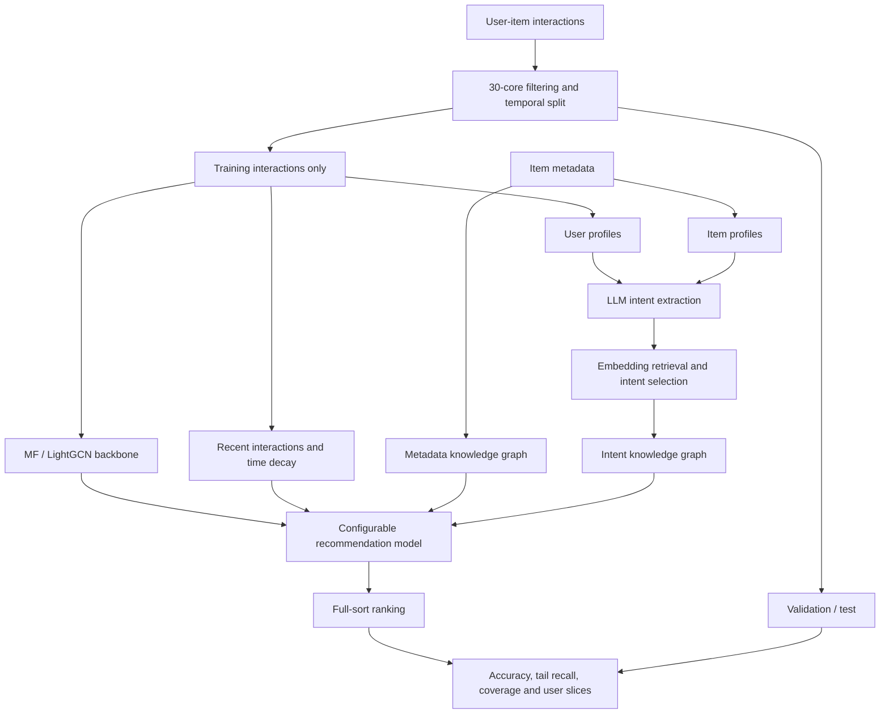

# Evaluating LLM-Derived Intent, Metadata, and Recency in Recommender Systems

[한국어](README.md) | [English](README_EN.md)

`Python 3.11` · `PyTorch` · `RecBole` · `LLM / RAG` · `Knowledge Graph`

A graduation research project in Data Science at Hanyang University. We investigate how additional signals affect collaborative filtering (CF) on Goodreads Children and MovieLens 25M, focusing on ranking accuracy, long-tail recommendation, and differences across users. This repository packages both experiments into a unified codebase with reproduction instructions.

## 1. Motivation and research questions

Exploratory analysis suggested that attribute preferences, such as authors or brands, can persist even when the dominant category or genre changes between consecutive interactions. Motivated by this observation, we investigate how recommendation models can represent evolving interests alongside persistent preferences.

- Does combining item metadata and recency improve CF baselines?
- Does LLM-derived intent provide incremental value beyond metadata and recency?
- How do the effects vary across user activity levels, and what trade-offs arise between accuracy and long-tail recommendation?

## 2. Key findings

Selected results from the November 19, 2026 experiment report. Values are test NDCG@10 under the per-user chronological split (TO), averaged over three seeds.

| Model | MovieLens 25M | Goodreads Children |
|---|---:|---:|
| MF (KG-off) | 0.0876 | 0.0811 |
| BPR | 0.0877 | 0.0818 |
| LightGCN | 0.0848 | 0.0878 |
| MF + Meta KG + Recency | 0.0892 | 0.0849 |
| MF + Meta KG + Recency + Intent | 0.0893 | 0.0845 |
| LightGCN + Meta KG + Recency | 0.0883 | 0.0864 |

- **Metadata + recency:** relative NDCG@10 improvements over MF were **+1.8%** on MovieLens and **+4.7%** on Goodreads.
- **LLM intent:** incremental gains were inconsistent. The small increase for MovieLens MF was not significant in the reported paired test, and performance decreased for Goodreads MF.
- **Long-tail trade-off:** on Goodreads, augmenting LightGCN with metadata and recency increased Tail Recall@10 from 0.0100 to 0.0154, while NDCG@10 decreased from 0.0878 to 0.0864.
- **User heterogeneity:** on Goodreads, additional signals tended to benefit less-active users and hurt more-active users. This is not established as a general pattern across datasets.

These are selected historical reported results, not a new run of the public package. The joint effect of metadata and recency should not be confused with separate channel-level ablations.

## 3. Model and pipeline



| Component | Role |
|---|---|
| MF / BPR / LightGCN | Collaborative filtering baselines; augmented variants use MF or LightGCN backbones. |
| Metadata KG | Represents book attributes in Goodreads and movie genres in MovieLens as graph relations. |
| Recency | Represents recent training interactions using time-decayed weights. |
| LLM Intent KG | Extracts intents from user/item profiles, retrieves candidates using embeddings, and builds a graph after LLM selection. |

The main comparison includes seven models: MF, BPR, LightGCN, and two augmented variants per MF/LightGCN backbone (metadata + recency, with or without intent). Dedicated ablation runners support channel-level analysis.

## 4. Datasets and evaluation protocol

| Dataset | Users | Items | Interactions (after 30-core filtering) |
|---|---:|---:|---:|
| [Goodreads Children](https://cseweb.ucsd.edu/~jmcauley/datasets/goodreads.html) | 62,142 | 27,975 | 6,237,437 |
| [MovieLens 25M](https://grouplens.org/datasets/movielens/25m/) | 133,684 | 15,785 | 24,046,865 |

- **TO:** per-user chronological train/validation/test split (80/10/10), primary comparison for both datasets.
- **TO_GLOBAL:** global chronological split (70/10/20), additionally evaluated on MovieLens, with a warm-user-only report.
- **Shared settings:** 64-dimensional embeddings, up to 40 epochs, seeds 2020, 2021, and 2022; early stopping on validation NDCG@10.
- **Evaluation:** full-sort ranking, NDCG, Recall, Hit, Tail Recall, Coverage, and user activity/item popularity slices. User-level paired bootstrap and Wilcoxon tests support statistical comparison.
- **Leakage prevention:** user profiles, recency, activity and popularity statistics use training interactions only. Profile provenance is checked against the actual training split.

## 5. Repository structure

```text
.
├── reproduce.py
├── requirements.txt
├── experiments/
│   ├── goodreads/
│   │   ├── ikgr_core/
│   │   ├── prompts/
│   │   ├── scripts/
│   │   ├── tests/
│   │   └── run_pipeline.py
│   └── movielens/
│       ├── data_adapters/
│       ├── ikgr_core/
│       ├── prompts/
│       ├── scripts/
│       ├── tests/
│       └── run_pipeline.py
└── tests/
```

Entry points: [reproduce.py](reproduce.py), [Goodreads](experiments/goodreads/), [MovieLens](experiments/movielens/). Each experiment includes `config.yaml`, `eval_slices.py`, and `ikgr_core/model_ikgr.py` for configuration, evaluation, and model implementation.

## 6. Installation and reproduction

Use Python 3.11 and run commands from the repository root. Windows PowerShell / NVIDIA CUDA 12.1 example:

```powershell
py -3.11 -m venv .venv
.\.venv\Scripts\Activate.ps1
python -m pip install torch==2.3.0 --index-url https://download.pytorch.org/whl/cu121
python -m pip install -r requirements.txt
```

On Linux, use `python3.11 -m venv .venv` and `source .venv/bin/activate`, followed by the same installation commands. For CPU synthetic tests, use the PyTorch CPU index `https://download.pytorch.org/whl/cpu`. A GPU is recommended for full experiments; the Goodreads-specific intent filtering experiment requires CUDA.

### 6.1 Prepare data and estimate costs without an API key

```bash
python reproduce.py goodreads prepare
python reproduce.py movielens prepare
```

Replace `prepare` with `download` to download only. The runner verifies file sizes and SHA-256 checksums and reuses existing originals. Goodreads interaction, book and author JSON.gz files are stored in `experiments/goodreads/`; MovieLens CSVs are stored in `experiments/movielens/raw/ml-25m/`. [MovieLens checksum source](https://raw.githubusercontent.com/tensorflow/datasets/master/tensorflow_datasets/url_checksums/movielens.txt).

### 6.2 Run the full experiments

Copy the experiment's `.env.example` to `.env` and set `LUXIA_API_KEY`, or use a shared environment variable with that name. The API receives training-history-derived user profiles and item profiles. The configuration uses Luxia's GPT-4o-mini bridge and the `sentence-transformers/all-mpnet-base-v2` encoder.

```bash
python reproduce.py goodreads run --split TO
python reproduce.py movielens run --split TO
python reproduce.py movielens run --split TO_GLOBAL
```

The runner reuses completed stages and valid caches. Review the estimated calls and costs and confirm with `y` before the connectivity check and full calls. `--max-usd 50` blocks runs whose upper cost estimate exceeds USD 50; it is not a hard billing cap. Configure billing limits with the provider. Use `--seeds 2020` for a single seed. The first RAG run downloads the encoder from Hugging Face.

| Stage | Processing | Main outputs |
|---|---|---|
| 0 · A · T | Conversion, 30-core filtering, temporal data | `data/kc_k30/ikgr-custom/ikgr-custom.inter` |
| P · S | Training-only profiles and cost estimate | `profiles_k30_<split>.csv`, `llm_cost_estimate.json` |
| B · C | Intent extraction, retrieval and selection | `step1_intents.csv`, `step2_related_intents.csv` |
| D | Intent and metadata knowledge graphs | `kg_pack.pt`, `meta_kg_pack.pt` |
| E · R | Leakage checks, training, evaluation and reporting | `slice_eval_<split>_result.json`, `per_user_<split>/`, `report_<split>.md` |

Results are generated in each experiment's `run_k30_TO/` or `run_k30_TO_GLOBAL/`. MovieLens also generates `report_TO_GLOBAL_warm.md` for warm users.

### 6.3 Compare against historical results with frozen inputs

LLM outputs may differ even with identical prompts. Training with original frozen intents requires archived evaluation input bundles. **These bundles are not included in the public repository.** If you have authorized access, use a separate checkout from newly generated experiments, copy the corresponding bundles to each experiment's `data_bundle/`, and unpack them with checksum verification:

```bash
python experiments/goodreads/scripts/unpack_data_bundle.py
python reproduce.py goodreads evaluate --split TO
python experiments/movielens/scripts/unpack_data_bundle.py --split TO
python reproduce.py movielens evaluate --split TO
python experiments/movielens/scripts/unpack_data_bundle.py --split TO_GLOBAL
python reproduce.py movielens evaluate --split TO_GLOBAL
```

If stage D is already complete, run `evaluate` directly. The original Goodreads report's LightGCN+intent result used seed 2020, whereas the unified runner defaults to three seeds. MovieLens reported seven models × three seeds per split.

### 6.4 Ablation and user-level analysis

Prepare TO graphs and evaluation inputs first. Channel ablation evaluates two conditions × three seeds per dataset.

```bash
cd experiments/goodreads
python scripts/run_todo_5_8.py --run --phase all
python scripts/run_ablation_nov22.py all
python analyze_user_segments.py
cd ../movielens
python scripts/run_ablation_nov22.py all
python scripts/analyze_activity_ablation.py pair --label "MovieLens MF" --off_dir run_k30_TO/per_user_TO --off IKGR_kgoff --on IKGR_dyn_nointent --out analysis/activity_TO/movielens_mf
```

## 7. Tests

Use separate Python processes because experiment-specific modules share import names. Smoke tests use synthetic data, a mock API and a mock encoder, and are designed to check temporal splits, training, evaluation, cache resumption and leakage prevention. The smoke tests reset their work directory, so specify a fresh temporary path.

```powershell
$env:PYTHONUTF8 = "1"
python -m pytest -q tests
cd experiments/goodreads
python -m pytest -q tests
python -X utf8 tests/smoke_e2e.py --workdir "$env:TEMP/goodreads-smoke-$([guid]::NewGuid())"
cd ../movielens
python -m pytest -q tests
python -X utf8 tests/smoke_e2e.py --workdir "$env:TEMP/movielens-smoke-$([guid]::NewGuid())"
```

## 8. Limitations and public release scope

- Results cover two domains and 30-core-filtered interactions, not all recommendation settings or strict cold-start scenarios.
- LLM-derived intent is an estimate rather than observed ground-truth intent and is subject to API cost, response variability, and generic-intent noise.
- Accuracy, long-tail performance and coverage do not always improve together. Further validation of user-specific effects is needed.

## 9. Resources and provenance

- [UCSD Goodreads Book Graph](https://cseweb.ucsd.edu/~jmcauley/datasets/goodreads.html)
- [GroupLens MovieLens 25M](https://grouplens.org/datasets/movielens/25m/)
- [RecBole](https://github.com/RUCAIBox/RecBole)
- [LightGCN](https://arxiv.org/abs/2002.02126)
- [all-mpnet-base-v2](https://huggingface.co/sentence-transformers/all-mpnet-base-v2)
