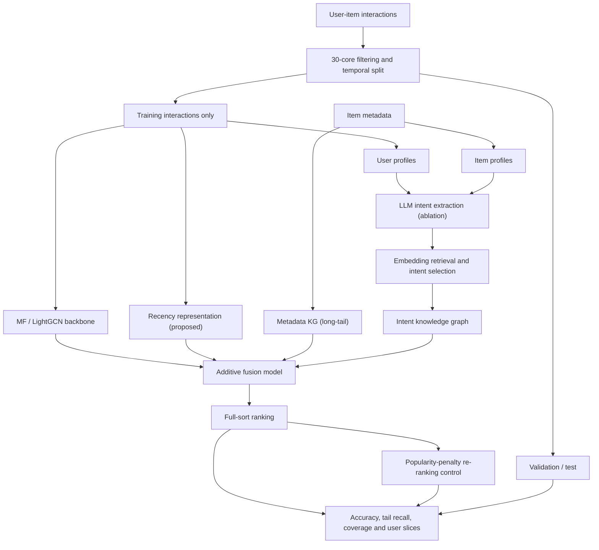

# Evaluating LLM-Derived Intent, Metadata, and Recency in Recommender Systems

[한국어](README.md) | [English](README_EN.md)

`Python 3.11` · `PyTorch` · `RecBole` · `LLM / RAG` · `Knowledge Graph`

This repository contains the experiment code and reproduction instructions for a Data Science graduation project at Hanyang University. We add three auxiliary signals to collaborative filtering (CF), switch each one on and off, and measure whether it actually improves ranking accuracy and long-tail recommendation on Goodreads Children and MovieLens 25M:

- user intents inferred by a large language model (LLM)
- an item metadata knowledge graph (Meta KG)
- recency

> **Key findings**
> - Accuracy gains come from recency. Adding only a recency representation to MF, our proposed model, improves NDCG@10 by +2.5% on MovieLens and +12.5% on Goodreads.
> - LLM-derived intent adds no further gain.
> - The metadata KG increases long-tail exposure rather than accuracy.

## 1. Motivation and research questions

Exploratory analysis ([graduate_eda](https://github.com/HK1DS/graduate_eda)) showed two patterns:
- Consecutively consumed items share attributes such as authors or brands more often than chance, even when the category changes.
- Interactions that are closer in time are more similar to each other.

Building on these observations, we ask:

- **RQ1.** Which signal (recency, the metadata KG, or LLM-derived intent) improves the accuracy of MF-based recommendation?
- **RQ2.** Does LLM-derived intent add value beyond the other signals?
- **RQ3.** What trade-off exists between accuracy and long-tail recommendation, and how can the metadata KG be used for long-tail recommendation?

## 2. Key findings

Test results under the per-user chronological split (TO), averaged over three seeds (2020, 2021, 2022). Brackets give user-level paired bootstrap 95% confidence intervals (CI).

| Model | Role | ML NDCG@10 | ML Tail R@10 | ML Cov@10 | GR NDCG@10 | GR Tail R@10 | GR Cov@10 |
|---|---|---:|---:|---:|---:|---:|---:|
| MF | baseline | 0.0876 | 0.0023 | 0.450 | 0.0811 | 0.0111 | 0.502 |
| BPR | baseline | 0.0877 | 0.0024 | 0.457 | 0.0818 | 0.0113 | 0.504 |
| LightGCN | baseline | 0.0848 | 0.0008 | 0.287 | 0.0878† | 0.0100† | 0.285† |
| **MF + Recency** | **proposed** | **0.0898** | 0.0020 | 0.398 | **0.0913** | 0.0110 | 0.405 |
| MF + Meta KG | ablation | 0.0867 | **0.0031** | **0.510** | 0.0819 | 0.0127 | **0.562** |
| MF + Meta KG + Recency | ablation | 0.0892 | 0.0022 | 0.413 | 0.0849 | 0.0128 | 0.451 |
| MF + Meta KG + Recency + Intent | ablation | 0.0893 | 0.0021 | 0.410 | 0.0845 | 0.0132 | 0.466 |
| LightGCN + Meta KG + Recency | long-tail comparison | 0.0883 | 0.0014 | 0.321 | 0.0864† | **0.0154**† | 0.458† |

- ML = MovieLens 25M, GR = Goodreads Children.
- Tail R@10: Recall@10 on items in the bottom 80% of training popularity.
- Cov@10: the share of all items that appear at least once in users' top-10 lists.
- † The Goodreads LightGCN models were run on different hardware and evaluation batches from the MF models, so we do not compare the two backbones directly.

**Recency (proposed model)**
- NDCG@10 over MF: +2.5% [+0.0019, +0.0025] on MovieLens and +12.5% [+0.0095, +0.0108] on Goodreads.
- The gain is significant in all five user-activity quintiles on both datasets.
- It adds a single scalar weight.
- Coverage@10 drops from 0.450 to 0.398 (MovieLens) and from 0.502 to 0.405 (Goodreads).

**LLM intent**
- No incremental gain.
- MF backbone: +0.1% [−0.0001, +0.0003] on MovieLens and −0.5% on Goodreads.
- LightGCN backbone: −0.8% on both datasets. The Goodreads LightGCN + intent model was run with seed 2020 only.

**Metadata KG**
- NDCG@10 changes little: −1.0% on MovieLens and +0.9% on Goodreads.
- Long-tail metrics increase:

| Metric | MovieLens | Goodreads |
|---|---|---|
| Tail Recall@10 | +35% | +14% |
| Coverage@10 | 0.45 → 0.51 | 0.50 → 0.56 |

**Interference when combined**
- Adding the metadata KG to recency in the same embeddings lowers NDCG@10 relative to recency alone: −0.7% on MovieLens and −7.8% on Goodreads.
- The +4.7% of the earlier combined model on Goodreads is therefore the +12.5% recency gain reduced by the metadata KG.

**Comparison with popularity correction (Goodreads)**
- We compared LightGCN with popularity-penalty re-ranking (λ = 0.25) against LightGCN + Meta KG + Recency without any penalty.
- Long-tail levels were similar (Tail R@10 0.0146 vs 0.0154).
- NDCG@10 was 6.5% higher for the metadata KG model [+0.0046, +0.0060].
- Coverage@10 was wider with the penalty (0.501 vs 0.458).
- MovieLens had no comparison point at a matching long-tail level.

**User activity**
- On Goodreads, the metadata KG helps less-active users (Q1 +3.2%, Q2 +2.0%) and hurts highly active users (Q4 −1.5%, Q5 −2.2%).
- On MovieLens, it hurts even the least-active quintile (Q1 −2.1%).

## 3. Model and pipeline



Each signal is added to the backbone embeddings (additive fusion) and can be switched on or off in the configuration.

```text
user  u = e_u + α_d · r_u  (+ α_k · k_u)
item  i = e_i + Σ_r α_r · m_{i,r}  (+ α_k · k_i)
score ŷ = uᵀ i,  BPR loss
```

| Component | Role |
|---|---|
| MF / BPR / LightGCN | CF baselines. Models with auxiliary signals use an MF or LightGCN backbone. |
| Recency (proposed) | Adds `r_u`, a time-decayed (τ = 180 days) weighted average of the item embeddings of the user's 50 most recent training interactions. The only added parameter is `α_d`. |
| Metadata KG (long-tail) | A graph that links items to attribute nodes. Adds relation-wise mean representations `m_{i,r}` weighted by `α_r`. Goodreads uses author, publisher, and shelf-tag relations; MovieLens uses genre. |
| LLM Intent KG (ablation) | A graph of intents built in two steps: (1) an LLM extracts intents from training-only profiles; (2) embedding kNN retrieves candidate intents, and the LLM selects the relevant ones. Intent embeddings are frozen. |
| Popularity-penalty re-ranking | Long-tail control. Subtracts `λ · σ_u · z(log(1 + pop_i))` from the trained scores and re-ranks, without retraining. |

## 4. Datasets and evaluation protocol

| Dataset | Users | Items | Interactions (after 30-core filtering) |
|---|---:|---:|---:|
| [Goodreads Children](https://cseweb.ucsd.edu/~jmcauley/datasets/goodreads.html) | 62,142 | 27,975 | 6,237,437 |
| [MovieLens 25M](https://grouplens.org/datasets/movielens/25m/) | 133,684 | 15,785 | 24,046,865 |

- **TO:** per-user chronological train/validation/test split (80/10/10). Used for the main comparison on both datasets.
- **TO_GLOBAL:** global chronological split (70/10/20). Evaluated additionally on MovieLens only, with a separate warm-user report.
- **Shared settings:** 64-dimensional embeddings, up to 40 epochs, seeds 2020, 2021, and 2022, early stopping on validation NDCG@10. All models are compared under the same training budget.
- **Evaluation:** full-sort ranking with NDCG, Recall, Hit, Tail Recall, and Coverage.
  - We also break results down by user-activity quintile and item popularity.
  - Statistical tests are user-level paired bootstrap (10,000 resamples) and Wilcoxon tests.
  - Long-tail items are the bottom 80% by training popularity.
- **Leakage prevention:** user profiles, LLM inputs, recency, and activity/popularity statistics are all built from training interactions only. Profile provenance is checked against the actual train split at evaluation time.

## 5. Repository structure

```text
.
├── reproduce.py
├── requirements.txt
├── experiments/
│   ├── goodreads/
│   │   ├── ikgr_core/
│   │   ├── prompts/
│   │   ├── scripts/
│   │   ├── tests/
│   │   └── run_pipeline.py
│   └── movielens/
│       ├── data_adapters/
│       ├── ikgr_core/
│       ├── prompts/
│       ├── scripts/
│       ├── tests/
│       └── run_pipeline.py
└── tests/
```

Entry points: [reproduce.py](reproduce.py), [Goodreads](experiments/goodreads/), [MovieLens](experiments/movielens/). Each experiment includes `config.yaml`, `eval_slices.py`, and `ikgr_core/model_ikgr.py` for configuration, evaluation, and model implementation.

## 6. Installation and reproduction

Use Python 3.11 and run commands from the repository root. Windows PowerShell / NVIDIA CUDA 12.1 example:

```powershell
py -3.11 -m venv .venv
.\.venv\Scripts\Activate.ps1
python -m pip install torch==2.3.0 --index-url https://download.pytorch.org/whl/cu121
python -m pip install -r requirements.txt
```

On Linux, use `python3.11 -m venv .venv` and `source .venv/bin/activate`, followed by the same installation commands. For CPU synthetic tests, use the PyTorch CPU index `https://download.pytorch.org/whl/cpu`. A GPU is recommended for full experiments; the Goodreads-specific intent filtering experiment requires CUDA.

### 6.1 Prepare data and estimate costs without an API key

```bash
python reproduce.py goodreads prepare
python reproduce.py movielens prepare
```

Replace `prepare` with `download` to download only. The runner verifies file sizes and SHA-256 checksums and reuses existing originals. Goodreads interaction, book and author JSON.gz files are stored in `experiments/goodreads/`; MovieLens CSVs are stored in `experiments/movielens/raw/ml-25m/`. [MovieLens checksum source](https://raw.githubusercontent.com/tensorflow/datasets/master/tensorflow_datasets/url_checksums/movielens.txt).

### 6.2 Run the full experiments

Copy the experiment's `.env.example` to `.env` and set `LUXIA_API_KEY`, or use a shared environment variable with that name. The API receives training-history-derived user profiles and item profiles. The configuration uses Luxia's GPT-4o-mini bridge and the `sentence-transformers/all-mpnet-base-v2` encoder.

```bash
python reproduce.py goodreads run --split TO
python reproduce.py movielens run --split TO
python reproduce.py movielens run --split TO_GLOBAL
```

The runner reuses completed stages and valid caches. Review the estimated calls and costs and confirm with `y` before the connectivity check and full calls. `--max-usd 50` blocks runs whose upper cost estimate exceeds USD 50; it is not a hard billing cap. Configure billing limits with the provider. Use `--seeds 2020` for a single seed. The first RAG run downloads the encoder from Hugging Face.

| Stage | Processing | Main outputs |
|---|---|---|
| 0 · A · T | Conversion, 30-core filtering, temporal data | `data/kc_k30/ikgr-custom/ikgr-custom.inter` |
| P · S | Training-only profiles and cost estimate | `profiles_k30_<split>.csv`, `llm_cost_estimate.json` |
| B · C | Intent extraction, retrieval and selection | `step1_intents.csv`, `step2_related_intents.csv` |
| D | Intent and metadata knowledge graphs | `kg_pack.pt`, `meta_kg_pack.pt` |
| E · R | Leakage checks, training, evaluation and reporting | `slice_eval_<split>_result.json`, `per_user_<split>/`, `report_<split>.md` |

Results are generated in each experiment's `run_k30_TO/` or `run_k30_TO_GLOBAL/`. MovieLens also generates `report_TO_GLOBAL_warm.md` for warm users.

### 6.3 Compare against historical results with frozen inputs

LLM outputs may differ even with identical prompts. Training with original frozen intents requires archived evaluation input bundles. **These bundles are not included in the public repository.** If you have authorized access, use a separate checkout from newly generated experiments, copy the corresponding bundles to each experiment's `data_bundle/`, and unpack them with checksum verification:

```bash
python experiments/goodreads/scripts/unpack_data_bundle.py
python reproduce.py goodreads evaluate --split TO
python experiments/movielens/scripts/unpack_data_bundle.py --split TO
python reproduce.py movielens evaluate --split TO
python experiments/movielens/scripts/unpack_data_bundle.py --split TO_GLOBAL
python reproduce.py movielens evaluate --split TO_GLOBAL
```

If stage D is already complete, run `evaluate` directly. The original Goodreads report's LightGCN+intent result used seed 2020, whereas the unified runner defaults to three seeds. MovieLens reported seven models × three seeds per split.

### 6.4 Ablation and user-level analysis

Prepare TO graphs and evaluation inputs first. The channel ablation runs two conditions with three seeds on each dataset:
- metadata only: `IKGR_meta_only_nov22`
- recency only, the proposed model: `IKGR_recency_only_nov22`

Together with MF (`IKGR_kgoff`) and the earlier combined model (`IKGR_dyn_nointent`), these form a 2×2 factorial decomposition.

```bash
cd experiments/goodreads
python scripts/run_todo_5_8.py --run --phase all
python scripts/run_ablation_nov22.py all
python analyze_user_segments.py
cd ../movielens
python scripts/run_ablation_nov22.py all
python scripts/analyze_activity_ablation.py pair --label "MovieLens MF" --off_dir run_k30_TO/per_user_TO --off IKGR_kgoff --on IKGR_dyn_nointent --out analysis/activity_TO/movielens_mf
python scripts/analyze_activity_ablation.py factorial --label "MovieLens MF" --base IKGR_kgoff=run_k30_TO --meta IKGR_meta_only_nov22=run_k30_TO/ablation_nov22 --rec IKGR_recency_only_nov22=run_k30_TO/ablation_nov22 --both IKGR_dyn_nointent=run_k30_TO --out analysis/activity_TO/movielens_factorial_test
```

Each `factorial` argument takes the form `SPEC=RUN_DIR`. The script reads `per_user_TO/` inside each run directory.

## 7. Tests

Use separate Python processes because experiment-specific modules share import names. Smoke tests use synthetic data, a mock API and a mock encoder, and are designed to check temporal splits, training, evaluation, cache resumption and leakage prevention. The smoke tests reset their work directory, so specify a fresh temporary path.

```powershell
$env:PYTHONUTF8 = "1"
python -m pytest -q tests
cd experiments/goodreads
python -m pytest -q tests
python -X utf8 tests/smoke_e2e.py --workdir "$env:TEMP/goodreads-smoke-$([guid]::NewGuid())"
cd ../movielens
python -m pytest -q tests
python -X utf8 tests/smoke_e2e.py --workdir "$env:TEMP/movielens-smoke-$([guid]::NewGuid())"
```

## 8. Limitations

**Data and conditions**
- **Number of datasets:** Amazon Clothing was excluded because of limited experiment credits (LLM API calls and rented GPUs). The final experiments use two datasets, Goodreads and MovieLens.
- **Filtering:** only the (30, 30)-core condition was used. Every user has at least 24 training interactions, so the results do not generalize to strict cold-start or sparser settings.

**Split**
- The main results come from the per-user chronological split (TO).
- On the MovieLens global chronological split (3,186 warm users), MF + Meta KG + Recency did not differ from MF (−0.4%, [−0.0037, +0.0018]).
- The recency-only proposed model was not evaluated on the global split.

**Comparison conditions**
- All models were compared under the same 40-epoch budget. Some baselines, such as Goodreads MF and LightGCN, stopped near this limit.
- We did not compare against sequential recommenders such as SASRec.

**Ablations not run**
- sensitivity to the recency τ and history length
- the metadata × recency 2×2 on the LightGCN backbone
- other intent configurations (a different LLM, a different embedding model, a learnable projection)
- popularity-penalty re-ranking applied to the recency-only model

**Interpretation**
- LLM-derived intent is an estimate rather than observed ground-truth intent, and it is affected by API cost, response variability, and generic-intent noise. We could not tell whether the null result stems from intent quality or from the fusion method.
- The cause of the interference between the metadata KG and recency is an untested hypothesis.
- The activity-dependent effect of the metadata KG was observed only on Goodreads.

## 9. Mapping from the report to the code

| Report | Topic | Code |
|---|---|---|
| Ch. 3 | User behavior analysis | [graduate_eda](https://github.com/HK1DS/graduate_eda) |
| Ch. 4 | Additive fusion model | `experiments/*/ikgr_core/model_ikgr.py` (`_emb_users`, `_emb_items`) |
| Ch. 4 | Recency representation | `_build_recency` in `experiments/*/eval_slices.py`. Defaults `recency_topn = 50` and `recency_tau_days = 180` are set in `model_ikgr.py` |
| Ch. 4 | Metadata KG | `experiments/*/build_meta_kg.py` |
| Ch. 4 | LLM intent | `experiments/*/step1.py`, `step2.py`, `prompts/`, `ikgr_core/rag.py`, `build_kg.py` |
| Ch. 4 | Leakage prevention | `experiments/*/build_trainonly_profiles.py`, `ikgr_core/temporal_split.py` |
| Ch. 5 | Baselines and main comparison | `reproduce.py`, `experiments/*/run_pipeline.py`, `config.yaml` |
| Ch. 5 | 2×2 ablation and activity analysis | `experiments/*/scripts/run_ablation_nov22.py`, `experiments/movielens/scripts/analyze_activity_ablation.py` |
| Ch. 5 | User-level paired tests | `experiments/*/paired_compare.py` |
| Ch. 6 | Popularity-penalty re-ranking | `_pop_penalty_scores` in `experiments/*/eval_slices.py` (`pop_rerank_grid`) |
| Ch. 7 | Global-split warm-user evaluation | `experiments/movielens/eval_global_warm.py` |

## 10. Resources and provenance

- [UCSD Goodreads Book Graph](https://cseweb.ucsd.edu/~jmcauley/datasets/goodreads.html)
- [GroupLens MovieLens 25M](https://grouplens.org/datasets/movielens/25m/)
- [RecBole](https://github.com/RUCAIBox/RecBole)
- [LightGCN](https://arxiv.org/abs/2002.02126)
- [all-mpnet-base-v2](https://huggingface.co/sentence-transformers/all-mpnet-base-v2)
- [KGIN](https://arxiv.org/abs/2102.07057)
- [KAR](https://arxiv.org/abs/2306.10933)
- [DynLLM](https://arxiv.org/abs/2405.07580)
- [CORONA](https://arxiv.org/abs/2506.17281)
