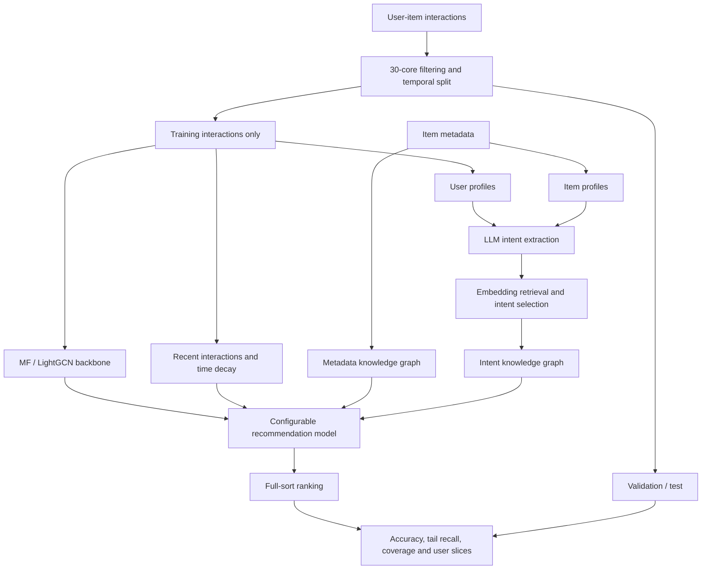

# Evaluating LLM-Derived Intent, Metadata, and Recency in Recommender Systems

**Recency for Accuracy, Metadata for the Long Tail**

[한국어](README.md) | [English](README_EN.md) | [Final report (PDF)](Evaluating%20LLM-Derived%20Intent%2C%20Metadata%2C%20and%20Recency%20in%20Recommender%20Systems.pdf) | [Research poster (PDF)](Kim_Yoo_Evaluating_LLM.pdf)

`Python 3.11` · `PyTorch` · `RecBole` · `LLM / RAG` · `Knowledge Graph`

Graduation research project, Department of Data Science, Hanyang University (2026) — Jin-Uk Kim and Eun-seon Yoo; project advisor: Hyun-Joon Kim.

We evaluate recency, item metadata, and LLM-derived intent as auxiliary signals for collaborative filtering (CF) on MovieLens 25M and Goodreads Children. **The proposed model is MF + Recency, which reuses the existing MF item embeddings and introduces just one trainable scalar.** Metadata and LLM intent are evaluated separately through ablations.

## 1. Motivation and research questions

Exploratory analysis of Amazon Clothing, MovieLens, and Goodreads found that consecutive items can retain attributes even when their primary categories change. Brand, series, and author retention exceeded the chance expectation by factors of 6.5, 3.8, and 16.4, respectively. These observations do not by themselves guarantee gains over an already-trained CF model. Amazon Clothing is used only for behavioral analysis.

- Does time-weighted recent history improve ranking accuracy over static CF?
- Does a metadata KG help retrieve relevant long-tail items independently of overall accuracy?
- How do the signals interact, what incremental value does LLM intent provide, and how do effects differ by user activity?

## 2. Final experimental results

Based on Tables 8–13 of the final report. Values are test results under the per-user chronological split (TO), averaged over three seeds (2020, 2021, 2022).

### 2.1 Proposed model versus baselines

| Model | MovieLens NDCG@10 | MovieLens Recall@10 | Goodreads NDCG@10 | Goodreads Recall@10 |
|---|---:|---:|---:|---:|
| BPR | 0.0877 | 0.0636 | 0.0818 | 0.0875 |
| LightGCN | 0.0848 | 0.0595 | 0.0878 | 0.0908 |
| MF | 0.0876 | 0.0636 | 0.0811 | 0.0870 |
| **MF + Recency (proposed)** | **0.0898** | **0.0655** | **0.0913** | **0.0962** |

Relative NDCG@10 gains over MF are **+2.5%** on MovieLens and **+12.5%** on Goodreads. Paired user-level bootstrap 95% CIs for absolute differences are [+0.0019, +0.0025] and [+0.0095, +0.0108], respectively. Comparisons across backbones remain subject to the common training budget and differences in some execution environments.

### 2.2 MF component ablations

| Model | ML NDCG@10 | ML Tail R@10 | ML Cov@10 | GR NDCG@10 | GR Tail R@10 | GR Cov@10 |
|---|---:|---:|---:|---:|---:|---:|
| MF | 0.0876 | 0.0023 | 0.450 | 0.0811 | 0.0111 | 0.502 |
| + Metadata KG | 0.0867 | **0.0031** | **0.510** | 0.0819 | 0.0127 | **0.562** |
| + Recency (proposed) | **0.0898** | 0.0020 | 0.398 | **0.0913** | 0.0110 | 0.405 |
| + KG + Recency | 0.0892 | 0.0022 | 0.413 | 0.0849 | 0.0128 | 0.451 |
| + KG + Recency + LLM Intent | 0.0893 | 0.0021 | 0.410 | 0.0845 | **0.0132** | 0.466 |

- **Recency:** improves accuracy in both domains but reduces Coverage@10.
- **Metadata KG:** alone increases Tail Recall@10 over MF by approximately 35% on MovieLens and 14% on Goodreads, while also increasing coverage.
- **Non-additive fusion:** KG + Recency yields approximately 0.7% lower NDCG@10 on MovieLens and 7.0% lower on Goodreads than Recency alone. Independent gains do not transfer additively to the combined model.
- **LLM intent:** no confirmed incremental accuracy gain under fixed projection and additive fusion. The small MovieLens MF improvement is not statistically significant, and Goodreads MF accuracy decreases. This does not establish that all LLM-based recommendation approaches are ineffective.

### 2.3 User activity and long-tail analysis

Users are divided into quintiles by training interaction counts (Q1: least active; Q5: most active).

| MF + Recency compared with | Q1 | Q2 | Q3 | Q4 | Q5 |
|---|---:|---:|---:|---:|---:|
| MovieLens MF | +2.7% | +3.2% | +3.5% | +3.2% | +1.5% |
| Goodreads MF | +15.0% | +14.1% | +13.5% | +8.7% | +8.5% |
| Goodreads LightGCN | +10.4% | +8.8% | +5.9% | −1.0% | −9.6% |

On Goodreads, adding KG alone to MF benefits lower-activity users (Q1–Q2) and hurts higher-activity users (Q4–Q5), but the pattern is not established across both domains. Activity-level tests are not adjusted for multiple comparisons.

On Goodreads, LightGCN + KG + Recency increases Tail Recall@10 from 0.0100 to 0.0154 and coverage from 0.285 to 0.458 relative to LightGCN, while NDCG@10 decreases from 0.0878 to 0.0864. Compared with popularity-penalized LightGCN (Tail Recall 0.0146, NDCG 0.0811), it achieves higher accuracy at comparable tail recall but lower coverage. Because the comparison changes both KG and recency, the difference cannot be attributed to KG alone.

**Conclusion:** ranking accuracy and relevant long-tail item retrieval should be evaluated as distinct objectives. Score-level fusion and user-dependent selection of recency/metadata are future research directions, not validated methods in this study.

These are historical results reported in the final report, not a new run of the public package.

## 3. Model and pipeline

### 3.1 Proposed model: MF + Recency

Use up to 50 recent training interactions and a fixed decay constant of 180 days, measured relative to the last training interaction. Compute a time-decayed weighted average of existing item embeddings.

$$
w_{uj}=\frac{\exp(-(t_u^{\mathrm{last}}-t_{uj})/\tau)}{\sum_{k\in H_u}\exp(-(t_u^{\mathrm{last}}-t_{uk})/\tau)},\qquad d_u=\sum_{j\in H_u}w_{uj}q_j
$$

$$
s(u,i)=(p_u+\alpha_d d_u)^\top q_i=p_u^\top q_i+\alpha_d\sum_{j\in H_u}w_{uj}q_j^\top q_i
$$

Here $p_u$ and $q_i$ are MF user/item embeddings, $H_u$ is recent training history, and $\alpha_d$ is one trainable scalar with an unconstrained sign. The model augments the original CF score with time-weighted item–item inner products, without requiring LLM calls or a KG.

### 3.2 Shared experimental pipeline



| Component | Role |
|---|---|
| MF / BPR / LightGCN | CF baselines; augmented variants use MF or LightGCN backbones. |
| Metadata KG | Represents Goodreads book attributes and MovieLens genres as graph relations. |
| Recency | Represents recent training interactions using time-decayed weights. |
| LLM Intent KG | Extracts intents from user/item profiles, retrieves candidates using embeddings, and builds a graph after LLM selection. |

The default runner compares seven models: MF, BPR, LightGCN, and two augmented variants per MF/LightGCN backbone (metadata + recency, with or without intent). The standalone MF + KG and MF + Recency variants are evaluated using the channel ablation runners in Section 6.4.

## 4. Datasets and evaluation protocol

| Dataset | Users | Items | Interactions (after 30-core filtering) |
|---|---:|---:|---:|
| [Goodreads Children](https://cseweb.ucsd.edu/~jmcauley/datasets/goodreads.html) | 62,142 | 27,975 | 6,237,437 |
| [MovieLens 25M](https://grouplens.org/datasets/movielens/25m/) | 133,684 | 15,785 | 24,046,865 |

- TO: per-user chronological 80/10/10. TO_GLOBAL: global chronological 70/10/20 (additional MovieLens evaluation, including warm users).
- Shared settings: 64-dimensional embeddings, Adam (lr 0.001, L2 1e-6), up to 40 epochs, seeds 2020, 2021, 2022; early stopping on validation NDCG@10. Batch sizes: MovieLens 8192, Goodreads 2048.
- Full-sort evaluation: NDCG@10 (ranking accuracy), Recall@10, Tail Recall@10 (recall for relevant items in the bottom 80% of training popularity, among users with such targets), Coverage@10 (fraction of the catalog appearing in the recommendation lists). User-level paired bootstrap and Wilcoxon tests.
- User profiles, recency, activity and popularity statistics use training interactions only. See Section 8 for global temporal leakage and catalog timestamp limitations.

## 5. Repository structure

```text
.
├── README.md
├── README_EN.md
├── reproduce.py
├── requirements.txt
├── experiments/
│   ├── goodreads/
│   │   ├── ikgr_core/
│   │   ├── prompts/
│   │   ├── scripts/
│   │   ├── tests/
│   │   └── run_pipeline.py
│   └── movielens/
│       ├── data_adapters/
│       ├── ikgr_core/
│       ├── prompts/
│       ├── scripts/
│       ├── tests/
│       └── run_pipeline.py
└── tests/
```

Entry points: [reproduce.py](reproduce.py), [Goodreads](experiments/goodreads/), [MovieLens](experiments/movielens/). Each experiment includes `config.yaml`, `eval_slices.py`, and `ikgr_core/model_ikgr.py` for configuration, evaluation, and model implementation.

## 6. Installation and reproduction

Use Python 3.11 and run commands from the repository root. Windows PowerShell / NVIDIA CUDA 12.1 example:

```powershell
py -3.11 -m venv .venv
.\.venv\Scripts\Activate.ps1
python -m pip install torch==2.3.0 --index-url https://download.pytorch.org/whl/cu121
python -m pip install -r requirements.txt
```

On Linux, use `python3.11 -m venv .venv` and `source .venv/bin/activate`, followed by the same installation commands. For CPU synthetic tests, use the PyTorch CPU index `https://download.pytorch.org/whl/cpu`. A GPU is recommended for full experiments; the Goodreads-specific intent filtering experiment requires CUDA.

### 6.1 Prepare data and estimate costs without an API key

```bash
python reproduce.py goodreads prepare
python reproduce.py movielens prepare
```

Replace `prepare` with `download` to download only. The runner verifies file sizes and SHA-256 checksums and reuses existing originals. Goodreads JSON.gz files are stored in `experiments/goodreads/`; MovieLens CSVs are stored in `experiments/movielens/raw/ml-25m/`. [MovieLens checksum source](https://raw.githubusercontent.com/tensorflow/datasets/master/tensorflow_datasets/url_checksums/movielens.txt).

### 6.2 Run the full experiments

Copy the experiment's `.env.example` to `.env` and set `LUXIA_API_KEY`, or use a shared environment variable with that name. The API receives training-history-derived user profiles and item profiles. The configuration uses Luxia's GPT-4o-mini bridge and the `sentence-transformers/all-mpnet-base-v2` encoder.

```bash
python reproduce.py goodreads run --split TO
python reproduce.py movielens run --split TO
python reproduce.py movielens run --split TO_GLOBAL
```

The runner reuses completed stages and valid caches. Review estimated calls and costs and confirm with `y` before the connectivity check and full calls. `--max-usd 50` blocks runs whose upper cost estimate exceeds USD 50; it is not a hard billing cap. Configure billing limits with the provider. Use `--seeds 2020` for a single seed. The first RAG run downloads the encoder from Hugging Face.

| Stage | Processing | Main outputs |
|---|---|---|
| 0 · A · T | Conversion, 30-core filtering, temporal data | `data/kc_k30/ikgr-custom/ikgr-custom.inter` |
| P · S | Training-only profiles and cost estimate | `profiles_k30_<split>.csv`, `llm_cost_estimate.json` |
| B · C | Intent extraction, retrieval and selection | `step1_intents.csv`, `step2_related_intents.csv` |
| D | Intent and metadata knowledge graphs | `kg_pack.pt`, `meta_kg_pack.pt` |
| E · R | Leakage checks, training, evaluation and reporting | `slice_eval_<split>_result.json`, `per_user_<split>/`, `report_<split>.md` |

Results are generated in each experiment's `run_k30_TO/` or `run_k30_TO_GLOBAL/`. MovieLens also generates `report_TO_GLOBAL_warm.md` for warm users.

### 6.3 Compare against historical results with frozen inputs

LLM outputs may differ even with identical prompts. Training with original frozen intents requires archived evaluation input bundles. **These bundles are not included in the public repository.** If you have authorized access, use a separate checkout from newly generated experiments, copy the corresponding bundles to each experiment's `data_bundle/`, and unpack them with checksum verification:

```bash
python experiments/goodreads/scripts/unpack_data_bundle.py
python reproduce.py goodreads evaluate --split TO
python experiments/movielens/scripts/unpack_data_bundle.py --split TO
python reproduce.py movielens evaluate --split TO
python experiments/movielens/scripts/unpack_data_bundle.py --split TO_GLOBAL
python reproduce.py movielens evaluate --split TO_GLOBAL
```

If stage D is already complete, run `evaluate` directly. The supplementary Goodreads LightGCN+intent result used seed 2020, whereas the unified runner defaults to three seeds.

### 6.4 Ablation and user-level analysis

Prepare TO graphs and evaluation inputs first. Channel ablation evaluates two conditions × three seeds per dataset.

```bash
cd experiments/goodreads
python scripts/run_todo_5_8.py --run --phase all
python scripts/run_ablation_nov22.py all
python analyze_user_segments.py
cd ../movielens
python scripts/run_ablation_nov22.py all
python scripts/analyze_activity_ablation.py pair --label "MovieLens MF" --off_dir run_k30_TO/per_user_TO --off IKGR_kgoff --on IKGR_dyn_nointent --out analysis/activity_TO/movielens_mf
```

## 7. Tests

Use separate Python processes because experiment-specific modules share import names. Smoke tests use synthetic data, a mock API and a mock encoder, and check temporal splits, training, evaluation, cache resumption and leakage prevention. Specify a fresh temporary path because the smoke tests reset their working directory.

```powershell
$env:PYTHONUTF8 = "1"
python -m pytest -q tests
cd experiments/goodreads
python -m pytest -q tests
python -X utf8 tests/smoke_e2e.py --workdir "$env:TEMP/goodreads-smoke-$([guid]::NewGuid())"
cd ../movielens
python -m pytest -q tests
python -X utf8 tests/smoke_e2e.py --workdir "$env:TEMP/movielens-smoke-$([guid]::NewGuid())"
```

## 8. Limitations and future work

- Results cover two 30-core-filtered domains and static CF baselines, not sequential models such as SASRec or strict cold-start scenarios.
- Per-user chronological splitting does not guarantee global chronological order. In the MovieLens global split warm-user evaluation, KG + Recency differs from MF by −0.4% (95% CI [−0.0037, +0.0018] for absolute NDCG difference); Recency alone was not evaluated under that split. Goodreads shelf tags reflect catalog information accumulated up to collection time.
- Some baselines are still improving near the common 40-epoch budget; GPU hardware and evaluation batch sizes differ across some backbones. Uniform history averaging, history-length/decay sensitivity, and a full 2×2 LightGCN ablation remain to be evaluated.
- LLM intent experiments are limited to one extractor, fixed projection, and additive fusion; the supplementary Goodreads LightGCN + intent comparison uses one seed.
- Activity-level multiple-comparison adjustment, score-level fusion, user-dependent selection, and online evaluation remain future work. Observed accuracy/long-tail Pareto frontiers are limited to the reported mean values.

## 9. Resources and provenance

- [UCSD Goodreads Book Graph](https://cseweb.ucsd.edu/~jmcauley/datasets/goodreads.html)
- [GroupLens MovieLens 25M](https://grouplens.org/datasets/movielens/25m/)
- [RecBole](https://github.com/RUCAIBox/RecBole)
- [LightGCN](https://arxiv.org/abs/2002.02126)
- [all-mpnet-base-v2](https://huggingface.co/sentence-transformers/all-mpnet-base-v2)

## 10. License and citation

- **Software:** Original project source code and software documentation without a separate license are available under the [MIT License](LICENSE). The existing [Apache License 2.0](experiments/goodreads/LICENSE) applies within `experiments/goodreads/`; existing third-party licenses, copyright and attribution notices remain in effect.
- **Research report and poster:** The two PDF research documents are excluded from the MIT license. All rights are reserved by their respective copyright holders, subject to uses permitted by applicable copyright law, including lawful quotation.
- **Data and external dependencies:** [MovieLens 25M](https://grouplens.org/datasets/movielens/25m/) and [Goodreads Children](https://cseweb.ucsd.edu/~jmcauley/datasets/goodreads.html) remain subject to their original providers' terms. External libraries, models, APIs, and their outputs are subject to their respective terms. The repository's MIT license does not alter those rights.

If you use this software or research, please cite the project using [CITATION.cff](CITATION.cff) or GitHub's “Cite this repository” feature.

> Kim, J.-U., & Yoo, E.-S. (2026). *Evaluating LLM-Derived Intent, Metadata, and Recency in Recommender Systems*. Graduation research project, Department of Data Science, Hanyang University.
